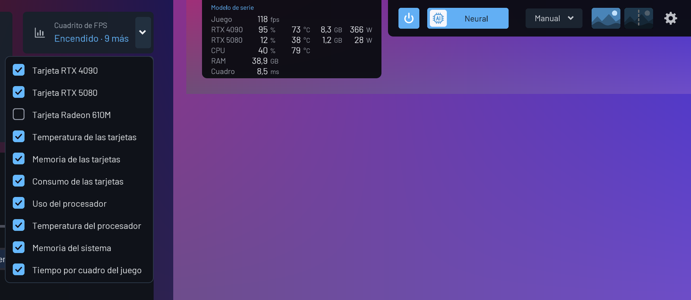
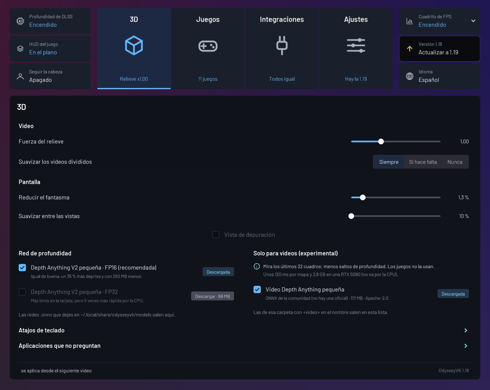
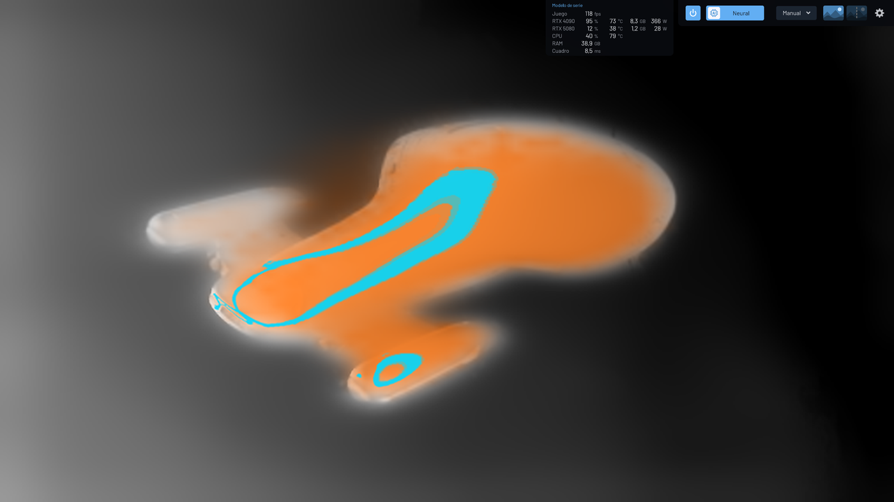
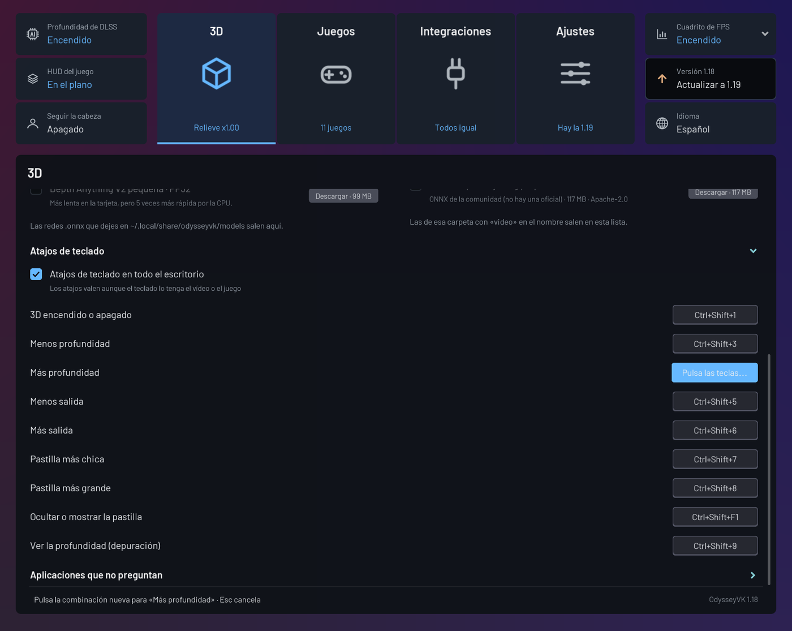
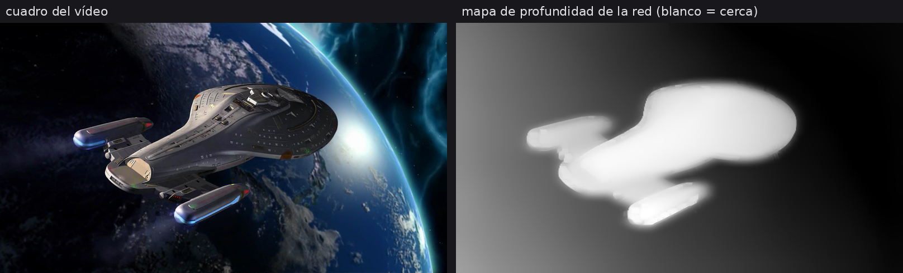
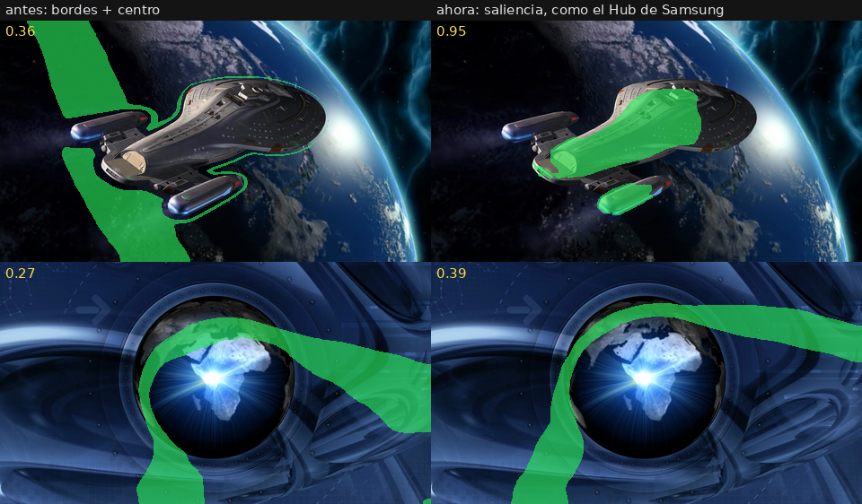
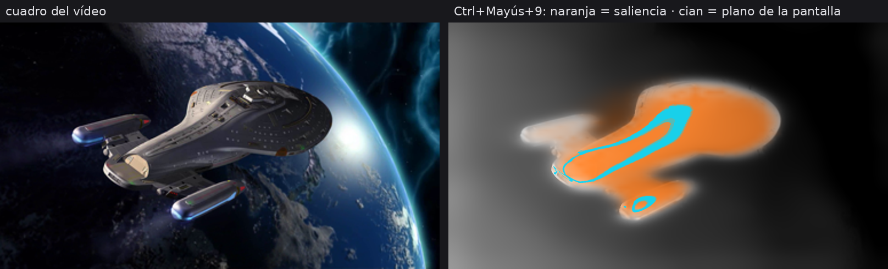
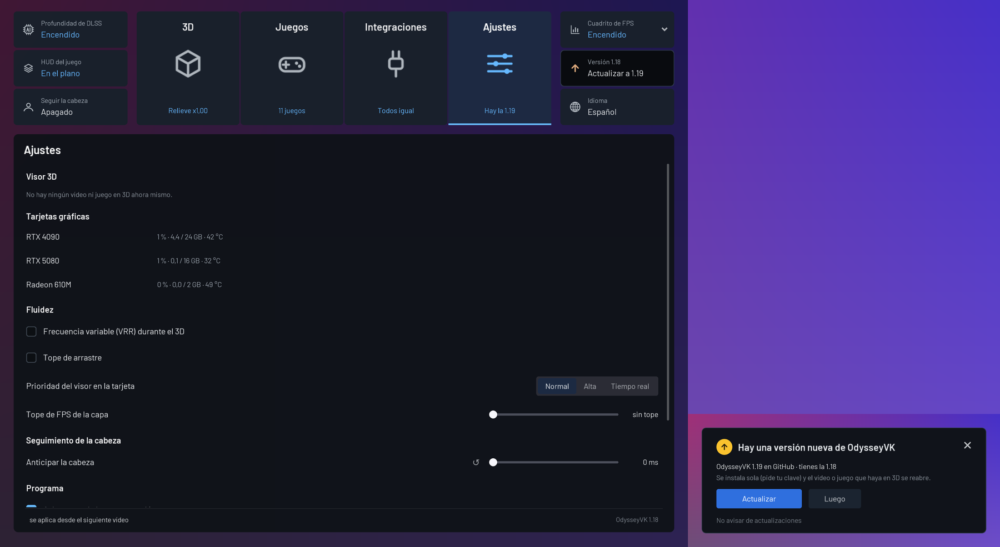
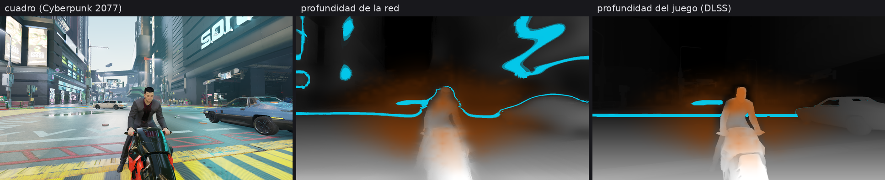
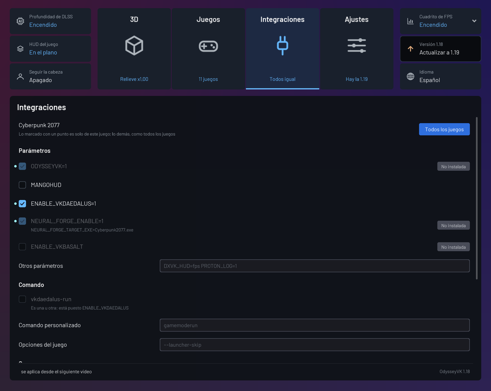

# OdysseyVK — 3D sin gafas en el Samsung Odyssey 3D (G90XF) para Linux

[English](README.md) · **Español**

OdysseyVK maneja el Samsung Odyssey 3D G90XF (lente lenticular y seguimiento de ojos) en **Linux
con Wayland** (KDE Plasma). Enciende la lente y el modo 3D del monitor, teje las dos vistas para
tus ojos, sigue tu cabeza con la cámara infrarroja del propio monitor y lo apaga todo al salir.
Samsung solo da programa para Windows; esto es un port hecho desde cero en C++ y Vulkan.

Lo que tienes:

- **Vídeos lado a lado y arriba-abajo** en 3D, desde cualquier reproductor o navegador a pantalla completa.
- **Vídeo normal (2D) a 3D** con una red de profundidad que corre en tu tarjeta gráfica (modelo abierto, se baja una vez).
- **Juegos** de tu biblioteca de Steam, cada uno con su interruptor 2D/3D.
- Un **panel de ajustes** flotante sobre el escritorio o el vídeo, en **7 idiomas** (English,
  Español, Français, Deutsch, 中文, 日本語, Русский), actualizaciones desde este repositorio y
  desinstalación con un clic.


## Lo nuevo de la 1.18

- **Vigila más que los FPS.** La flechita de la tesela *Cuadrito de FPS* abre una lista, como MangoHud: cada tarjeta
  en su fila (el uso y, si se marcan, su temperatura, memoria y consumo), el uso y la temperatura del procesador, la
  memoria del sistema y el tiempo por cuadro del juego. El cuadro se queda en la esquina de arriba a la derecha cuando
  la pastilla se oculta y, con algo marcado, sale también sobre los vídeos. Dice «DLSS» solo mientras la profundidad
  sale de ahí de verdad.
- **El 3D ya no parpadea al abrir o cerrar el panel**, y el navegador ya no pausa el vídeo: el visor se minimizaba
  solo cada vez que perdía el foco.
- **La tarjeta de «el juego se cerró»** solo sale si el juego se cierra en los 20 segundos de entrar en 3D (una
  caída), no al salir tú.
- **Una instalación en silencio**: `install.sh` enseña unas pocas líneas; el detalle va a `build/compilacion.log`.

| | Antes | 1.18 |
|---|---|---|
| Abrir o cerrar el panel sobre un vídeo | el 3D se rehacía y el vídeo se pausaba | al vídeo no le pasa nada |
| Hacer clic en el vídeo | lo mismo | el 3D vuelve encima en ~20 ms |
| Leer 3 tarjetas, el procesador y la memoria para el cuadro | — | 0,9 ms, una vez por segundo |
| Avisos del compilador al instalar | 561 | 0 |



### Lo nuevo de la 1.17

- **Mira la profundidad mientras eliges la red.** La casilla *Vista de depuración* de la pestaña 3D enseña la
  profundidad en vivo y deja el panel en una columna a la izquierda. Cambias de red y ves la diferencia al momento;
  junto a la casilla, lo que cuesta la red, cada segundo.
- **Usa la red de profundidad que quieras.** La pestaña 3D tiene dos listas lado a lado: las redes de siempre y las
  de solo vídeos. Cualquier `.onnx` de profundidad que dejes en `~/.local/share/odysseyvk/models` sale ahí; una lista
  con más de dos pasa a ser un desplegable.
- **Una red que mira el tiempo (experimental, solo vídeos):** Video Depth Anything pequeña mira los últimos 32 cuadros,
  así que la profundidad salta menos de un cuadro al siguiente. Ve los cambios de plano en la imagen, así que un plano
  nuevo empieza limpio.
- **Tarjetas AMD:** la red del 2D→3D puede ir por ROCm (aún sin probar en una AMD de verdad).
- **La primera vez que una aplicación se pone a pantalla completa,** una ventanita pregunta 3D o 2D y lo recuerda.
- **Más ligera en NVIDIA:** 30 MB menos de memoria por red y, con dos tarjetas, la otra ya no pierde 386 MB.

Medido en una RTX 5080:

| | Descarga | Tiempo por mapa de profundidad | Memoria en la tarjeta | Para |
|---|---|---|---|---|
| Depth Anything V2 pequeña FP16 (la recomendada) | 50 MB | 4,3 ms | 640 MB | vídeos y juegos |
| Depth Anything V2 pequeña FP32 | 99 MB | 7,3 ms | 1 GB | la CPU, donde va 5 veces más rápida que la FP16 |
| Video Depth Anything pequeña | 117 MB | 122 ms | 2,8 GB | solo vídeos |

| Red de vídeo en un cambio de plano | Antes | Ahora |
|---|---|---|
| Profundidad del plano nuevo | hasta un 20 % desviada, de 2 a más de 7 segundos | bien desde el primer mapa |
| Cortes falsos en 7 segundos de una persona hablando | 1 o 2 | ninguno |





## Instalar

Arch / CachyOS, todo de una vez (una NVIDIA con CUDA, o una AMD con ROCm, para el conversor 2D→3D; lo demás va en
cualquier tarjeta con Vulkan 1.3):

```bash
sudo pacman -S --needed cmake gcc pkgconf git glfw openssl libpng freetype2 vulkan-icd-loader vulkan-headers glslang wayland plasma-wayland-protocols libpipewire systemd-libs mpv onnxruntime-cuda cuda cudnn
```

Con una tarjeta **AMD**, cambia `onnxruntime-cuda cuda cudnn` por `onnxruntime-rocm` (aún sin probar en una AMD de
verdad): el conversor va entonces en la tarjeta con ROCm, con el motor MIGraphX de ONNX Runtime. La primera
vez de cada sesión la red se prepara para la tarjeta y puede tardar. Si el procesador trae gráfica Radeon integrada,
la red va a la tarjeta con más memoria (`HIP_VISIBLE_DEVICES` fija una). Sin motor para la tarjeta, la red va por la
CPU. La profundidad de DLSS de los juegos es solo de NVIDIA.

```bash
git clone https://github.com/the-cave-dweller/Odyssey3d-linux.git && cd Odyssey3d-linux && ./install.sh
```

`install.sh` compila (en silencio: el detalle va a `build/compilacion.log` y sale si algo falla), pide tu clave una
vez (binario, regla udev y datos de calibración), instala la entrada del menú y arranca el servicio de usuario. Luego comprueba que el monitor se ve:

```bash
odysseyvk doctor
```

`doctor` tiene que listar la lente (`/dev/ttyACM0`), el scaler (`/dev/sgN`, vendor `GCREADER`), la
cámara (`04e8:20d7`) y el panel en 4K. Si no los ve, **desenchufa y vuelve a enchufar el cable USB-B
del monitor** una vez (la regla udev se aplica al reconectar). Nunca hagas `udevadm trigger` sobre
el monitor: reinicia su hub interno y la lente, el scaler y la cámara desaparecen hasta reconectar.

La primera vez que el servicio arranca sin red de profundidad, el panel de ajustes se abre solo en su pestaña 3D,
que lista las redes con su casilla: Depth Anything V2 pequeña, de
[huggingface.co/onnx-community/depth-anything-v2-small](https://huggingface.co/onnx-community/depth-anything-v2-small),
en **FP16** (la recomendada: el mismo mapa que la FP32, más rápida y más ligera) o **FP32**. La que aún no está bajada
sale en gris: al picarla se baja y queda puesta; las bajadas llevan una etiqueta azul, y la marcada es la que se usa.
Cualquier otra red de profundidad `.onnx` que pongas en `~/.local/share/odysseyvk/models` sale en la misma lista. Al
acabar la primera descarga el panel se cierra y la red se carga. Desde la terminal es:

```bash
odysseyvk ctl net download        # FP16
odysseyvk ctl net download fp32   # FP32
```

Cuando la red tiene que ir por el procesador (sin motor para la tarjeta, o sin sitio en ninguna), OdysseyVK usa la
FP32 en vez de la FP16 si está bajada: en la CPU va unas 5 veces más rápida (298 contra 1447 ms por mapa, medido por
[Noa3](https://github.com/Noa3) en un Ryzen 9 7950X3D). Con dos tarjetas, `red = N` en `serve.conf` elige la tarjeta
CUDA N.

**Solo para vídeos (experimental):** a la derecha de la lista, *Solo para vídeos* ofrece
[Video Depth Anything](https://github.com/DepthAnything/Video-Depth-Anything) pequeña (una exportación a ONNX de la
comunidad del modelo Apache-2.0: no hay una oficial). Mira los últimos 32 cuadros en vez de uno, así que la
profundidad salta menos de un cuadro al siguiente (la mitad de cambios de cerca y lejos en un paisaje, algo menos con
una persona hablando). Cuesta mucho más trabajo de la tarjeta (mira la tabla de arriba), dentro de los 6 mapas por
segundo del visor, y no va por la CPU. Marcada, vale solo con los vídeos; los juegos siguen con la red de siempre.
Los cambios de plano se ven en la imagen antes de pasar la red, así que un plano nuevo empieza limpio. Cualquier
`.onnx` con «video» en el nombre sale en esa lista. Desde la terminal: `odysseyvk ctl net download video`. Con más de
dos redes en un lado, ese lado pasa a ser un desplegable.

**Probar las redes en vivo.** *Vista de depuración*, la casilla encima de las dos listas, pone la vista de depuración
de la profundidad del visor (la misma de `Ctrl+Mayús+9`, más abajo) y deja el panel en una columna a la izquierda: las
redes de siempre en la mitad de arriba, las de vídeo en la de abajo y el vídeo a la vista al lado. Junto a la casilla
sale lo que cuesta la red que va, cada segundo: milisegundos por mapa (la red sola y en total), mapas y cuadros por
segundo. Se elige otra red y se ve cambiar la profundidad; al quitar la casilla vuelve el panel entero. Hace falta un
vídeo o un juego abierto en 3D.


## Uso

Pon un vídeo a pantalla completa. La primera vez con cada aplicación (un navegador, un reproductor), una ventanita
arriba a la derecha, al estilo de la pastilla y con el color de su modo, pregunta **3D** o **2D**, con **Recordar
para esta aplicación** puesto; hasta que eliges no cambia nada en el monitor. 3D arranca el visor; 2D deja el vídeo
como está y, recordado, la aplicación se deja en paz desde entonces (las dos cosas se quitan en 3D → *Aplicaciones
que no preguntan*). Con 3D, en sus primeros segundos el visor distingue
un **vídeo normal** (una imagen, se convierte a 3D) de uno **dividido** (lado a lado o arriba y abajo),
se cambia solo y deja de mirar. Compara las dos mitades del cuadro —la imagen y su detalle fino— y se
midió con tres vídeos 3D lado a lado y tres normales (18 de 18 ventanas de 3 s bien en cada uno). Las
aplicaciones marcadas como 2D y los juegos siguen su camino.

La pastilla de arriba a la derecha, del alto de la barra de título del panel, se queda mientras dura el 3D: un botón
redondo de encendido (el 3D sí o no), el interruptor **Neural | Rendimiento** (la profundidad con la red o sacada de
la imagen en el procesador, y se cambia ahí mismo, en marcha), el botón del relieve (**Auto** o **Manual**, ver abajo;
en Manual su menú trae también Profundidad y Salida), los dos botones del tipo de vídeo (normal y dividido, para
cambiarlo a mano) y el engranaje que abre el panel de ajustes. Al dejar el ratón encima enseña los atajos. Se oculta
sola a los 5 segundos sin el ratón cerca; llevar el ratón a la orilla de arriba de la pantalla, donde estaba, la trae
de vuelta. Sin conversor (un vídeo dividido tal cual, o sin red de profundidad) el botón del relieve es solo Manual.

Teclas (valen aunque el teclado lo tenga el vídeo o el juego):

| Teclas | Qué |
|---|---|
| `Ctrl+Shift+1` | 3D sí / no |
| `Ctrl+Shift+3` / `4` | menos / más profundidad |
| `Ctrl+Shift+5` / `6` | menos / más salida |
| `Ctrl+Shift+F1` | ocultar / mostrar la pastilla |
| `Ctrl+Shift+9` | vista de depuración de la profundidad (plana, sin 3D): la profundidad en gris (blanco = cerca), en naranja donde pesa la saliencia (la que elige el plano de la pantalla en Auto) y en cian lo que cae en el plano de la pantalla; otra vez para volver |
| `Esc` (en el visor) | salir del 3D |

Cada atajo se cambia en la página principal del panel → **Atajos de teclado** (la sección se pliega con la flechita de su
cabecera, como *Aplicaciones que no preguntan*; las dos empiezan plegadas): pícalo y pulsa la combinación nueva
o una tecla sola (Esc cancela y la flecha circular vuelve a la de fábrica). Una tecla sola, o con
Mayús nada más, también vale: mientras haya 3D, esa tecla ya no llega al vídeo ni al juego, y el panel lo avisa al
ponerla. Vale cualquier letra, número o signo, F1–F24, las flechas y las de moverse por la página, Espacio,
Pausa/Inter, Impr Pant, Bloq Despl y Menú. Mientras el
panel de ajustes está abierto se queda con todo el teclado, así que el juego de debajo no recibe
teclas; Esc lo cierra.



El panel de ajustes se abre con el engranaje de la pastilla, la entrada OdysseyVK del menú, su
icono en la barra de tareas o el de la bandeja del sistema (clic: ajustes, clic central: juegos). Ocupa
la pantalla entera al estilo del menú de vkDaedalus, del mismo tamaño en el escritorio y sobre un juego: una barra de
título con el aspa; en medio una tesela grande por
pestaña —**3D** (vídeo, pantalla, la red de profundidad, atajos de teclado, aplicaciones que no preguntan),
**Juegos**, **Integraciones** (las opciones de lanzamiento de Steam de cada juego; ver más abajo) y
**Ajustes** (los datos de rendimiento —visor 3D, tarjetas gráficas— y lo demás: fluidez, la anticipación de la
cabeza, actualizaciones, barra de tareas y bandeja, y **Desinstalar** plegado bajo su flechita)—; y a cada lado tres
teselas chicas que se cambian de un clic: la profundidad de DLSS, el HUD del juego, seguir la cabeza, el cuadrito de
FPS, la versión (buscar una actualización o instalarla) y el idioma. Cada opción ocupa una fila: su explicación sale
al dejar el ratón encima. Dentro de un juego Integraciones va en gris y en Juegos solo ese juego va en color; sobre
un vídeo Juegos también va en gris. Los colores siguen al modo: azul con la red, ámbar en Rendimiento. Todo está
también en `~/.config/odysseyvk/serve.conf`; el servicio toma los cambios sin reiniciarse.

### Idioma

La tesela del **Idioma** cambia el idioma al momento: el panel, la pastilla, las tarjetas y el
rótulo de la bandeja. De fábrica va en inglés. El chino y el japonés usan el tipo Noto Sans CJK
(`noto-fonts-cjk` en Arch).

## Qué hace bueno el 3D

**Profundidad desde una sola imagen.** En los vídeos normales una red de profundidad mira cada
cuadro y dice a qué distancia está cada píxel; el visor desplaza la imagen para cada ojo según eso.
Los límites de cerca y lejos son los del programa de Samsung, así que nada pasa de lo que la lente
puede enseñar limpio.



**Los bordes en su sitio.** El mapa de la red es basto (518 puntos a lo ancho de un cuadro 4K) y
sus bordes caen a unos milímetros del contorno real. OdysseyVK afina cada borde contra el color de
la imagen, píxel a píxel, para que el borde de cada objeto esté donde lo ves con los dos ojos.
Medido en cuadros reales: el borde queda a menos de 2 píxeles de la imagen en el 96 % de los bordes
(antes se iba 26 píxeles), sin fantasma del fondo al lado.


**La profundidad y la salida se recuerdan.** El vídeo normal y el dividido suavizado arrancan en
Profundidad 75 (el plano de la pantalla fijo en 0,75) y Salida 50; el dividido con su propio
relieve arranca neutro (50 y 0). Mueve cualquiera de los dos y ese valor queda recordado para ese
tipo de vídeo, cada uno por su lado.

**Lo que miras puede quedarse en la pantalla.** Con `profundidad_conv = auto` el plano de la
pantalla se pone en lo que estás mirando, como hace el Hub de Samsung, así que caras y sujetos
quedan nítidos y el fondo se abre detrás. En
verde, lo que queda en el plano de la pantalla (medido con la 1.07 en cuadros reales): sin
saliencia el plano caía en el espacio detrás de la nave (0,36); ahora es la nave (0,95). En el
globo pasa del fondo del cuadro al borde del globo (0,27 → 0,39).



**Ver de qué está hecho el 3D.** `Ctrl+Mayús+9` cambia el 3D por una vista plana de la profundidad
que usa el visor, con los cantos afinados y los subtítulos apoyados: en gris la profundidad (blanco =
cerca), en naranja dónde pesa la saliencia (en Auto es la que elige el plano de la pantalla; el
naranja más vivo es lo que más pesó en ese cuadro) y en cian lo que cae en el plano de la pantalla, lo
que se queda quieto y nítido. Bajo la pastilla sale qué es cada color; otra vez el atajo y vuelve el
3D. Hace falta el conversor (un vídeo normal o uno dividido suavizado) y vale igual en Neural que en
Rendimiento. Abajo, el mismo cuadro de la nave: la saliencia cubre la nave y el plano de la pantalla
le recorre el casco.



**Los vídeos divididos demasiado hondos se domestican.** Algunos vídeos lado a lado separan lo
cercano varios centímetros, más de lo que la lente puede enseñar. El «vídeo dividido suavizado» usa
la imagen izquierda y el relieve del conversor, solo cuando hace falta.

**Los mandos del reproductor salen enteros.** En un vídeo dividido el reproductor pinta su barra
sobre las dos mitades. OdysseyVK encuentra esas filas y enseña los mandos una vez, sobre el vídeo,
que sigue suave y atenuado detrás; cuando la barra se esconde, el corte se va con ella.


**Juegos.** La pestaña Juegos lista tu biblioteca de Steam con carátulas; cada juego tiene su
interruptor 2D | 3D (con `modo = flat` en `~/.config/odysseyvk/serve.conf`, las ventanas a pantalla completa y
los juegos sin el interruptor puesto se quedan en 2D, y los interruptores lo dicen). Arráncalo desde ahí y el juego
entra solo en 3D al ponerse a pantalla
completa. Los juegos tienen que ir en **ventana sin bordes** (borderless, también con gamescope):
a pantalla completa exclusiva el escritorio pone el juego encima del 3D. Si un juego en 3D tapa el
visor o se cierra en los 20 segundos de entrar en 3D, OdysseyVK lo avisa con una tarjeta (la de que el juego
tapa el 3D se cierra sola con una cuenta atrás de 4 segundos en su botón). Al pasar el
ratón por una carátula sale un engranaje arriba a la derecha: abre las
[integraciones](#integraciones-las-opciones-de-lanzamiento-de-steam) de ese juego.


## Mantenerlo al día

El servicio mira este repositorio cada seis horas. Con una versión nueva sale una tarjeta en la
esquina con **Actualizar**, **Luego** y un pequeño «No avisar de actualizaciones»; en el panel, la tesela de la
**Versión** pone su flecha en ámbar y dice qué versión hay. Al
picarla se instala, o se vuelve a mirar si no hay nada nuevo. Actualizar baja, compila, instala (una ventana
pide tu clave), reinicia el servicio y reabre el vídeo o juego que estaba en 3D. La pestaña
**Ajustes** tiene además «Actualizar automáticamente» (apagado de fábrica) y **Desinstalar**.



## Configuración

`~/.config/odysseyvk/serve.conf`, una `clave = valor` por línea. Las que te pueden interesar:

| Clave | Qué hace |
|---|---|
| `idioma = en \| es \| fr \| de \| zh \| ja \| ru` | idioma de la interfaz (inglés de fábrica) |
| `modo = ask \| conv \| sbs` | preguntar con la tarjeta / siempre vídeo normal / siempre vídeo dividido |
| `auto = app:conv` | una aplicación que pasa directa al 3D («No volver a preguntar» escribe estas) |
| `pantalla = DP-4` | qué salida es el Odyssey |
| `rastreo = si` | seguir tus ojos con la cámara infrarroja del monitor (Ajustes → Seguimiento de la cabeza) |
| `relieve = 1,00` | fuerza del relieve del conversor (0,5 … 2) |
| `dividido_suavizado = si \| auto \| no` | suavizar los vídeos divididos: siempre / si hace falta / nunca |
| `crosstalk_base = 0,013` | cuánta imagen del otro ojo se resta (fantasma) |
| `filtro = 10` | pendiente del filtro de la trama entre las dos vistas: el paso de una a otra ocupa 1/pendiente del ciclo (el 10 de Samsung es casi un escalón; lo escribe «Suavizar entre las vistas» del panel) |
| `profundidad_conv = 75` / `salida_conv = 50` | Profundidad y Salida con que arranca el vídeo normal (`_suave` el dividido suavizado, `_sbs` el dividido); se escriben al mover los deslizadores; `profundidad_conv = auto` = plano automático |
| `hz = 165` | frecuencia del panel en 3D (120 de fábrica; el G90XF también va a 165) |
| `vrr_en_3d = si` | dejar la frecuencia variable (VRR) durante el 3D; de fábrica se apaga mientras dura el 3D (con ella puesta, los juegos por debajo del refresco daban tirones) |
| `atajo_3d = Ctrl+Shift+1` | un atajo (los escribe el panel): `atajo_profundidad_menos`, `atajo_profundidad_mas`, `atajo_salida_menos`, `atajo_salida_mas`, `atajo_pastilla_menos`, `atajo_pastilla_mas`, `atajo_pastilla` |
| `barra_tareas = no` / `bandeja = no` | quitar OdysseyVK de la barra de tareas / de la bandeja |
| `actualizaciones = no` / `actualizar_auto = si` | sin tarjeta de actualización / instalar solo |
| `actualizaciones_cada = 6` | horas entre miradas a este repositorio |

Lo demás (calibración del paso de la lente, seguimiento de cabeza, variables de taller) está en
las guías.

## Relieve: Auto y Manual

En el vídeo normal con la red la pastilla se vuelve azul claro: junto al interruptor, un botón con un
chip dice **Auto** o **Manual** y abre su menú.

- **Auto**: en cada escena un mapa de saliencia busca lo que llama la atención (una cara, un objeto) y
  lo deja en el plano de la pantalla. El alcance del relieve sigue la distancia de tus ojos (0,3° de
  paralaje entre los ojos, nunca menos que los topes de fábrica: esos hasta 75 cm, 1,33 veces ellos a 1 m), y la salida se calcula
  para el mayor relieve que cabe sin aplastar la imagen contra esos topes (medido: un 0,9 % del cuadro
  en los topes en vez del 61 % con una salida fija).
- **Manual**: Profundidad y Salida a mano, con el mismo alcance automático.

Los subtítulos y los rótulos se quedan en el plano de la pantalla, cada renglón de una pieza. Solo
cuentan los renglones de texto: las bandas de arriba y de abajo, donde van los subtítulos y los
cintillos, y en medio del cuadro solo un renglón de verdad, así que una cara, el estampado de una
camiseta o una ciudad llena de letreros conservan su profundidad. En los juegos (ventanas de Steam o
gamescope) las bandas solo toman renglones largos de subtítulo, y un personaje en tercera persona en
la parte de abajo no se aplana. En los
cantos, el escalón de profundidad sigue el color de la imagen, y lo que un objeto destapa al correrse
se rellena con el fondo de al lado.

## Modo rendimiento

Profundidad sin la red (`exp_sin_red = si`, el interruptor **Neural | Rendimiento** de la pastilla, en
marcha), sacada de la propia imagen en el procesador (~9 ms por mapa, sin CUDA y sin el ~1,1 GB que
ocupa la red en la tarjeta). Es más basta que la de la red, pero más estable. La pastilla se vuelve
ámbar y lleva un botón con un rayo: su menú desplegable tiene tres preajustes medidos (**Suave · Medio ·
Intenso**) y cuatro deslizadores finos (mezcla, fuerza, alcance y paralaje de la cabeza), que se
aplican al momento; al pasar el ratón por cada uno se ve qué cambia. En este modo la frecuencia
variable queda como la tenga el escritorio.

## Profundidad exacta en los juegos con DLSS

En los juegos que usan DLSS, OdysseyVK puede usar la profundidad del propio juego en vez de adivinarla
con la red: la que el juego le da a DLSS en cada cuadro, exacta y quieta, a la resolución de render
del juego (en Cyberpunk 2077, 1920×1080). Hace falta una tarjeta NVIDIA, DLSS puesto en el juego
(cualquier modo) y `ODYSSEYVK=1` en las opciones de lanzamiento de Steam del juego. Se pone para todos los juegos
con la casilla del pie de la pestaña Juegos del panel (al pasar el ratón recuerda para qué es), o para uno con el
engranaje de su carátula (Integraciones); los juegos a los que se les quitó uno a uno la siguen sin llevar y OdysseyVK la escribe en
Steam (con Steam cerrado; con Steam abierto, en cuanto se cierra); o se añade a mano:

```
ODYSSEYVK=1 %command%
```

Con eso se carga la pequeña capa de Vulkan de OdysseyVK solo en ese juego (la deja puesta
`install.sh`). La capa encuentra la profundidad que recibe DLSS y, mientras el 3D está puesto, la
tarjeta del juego la escribe directamente en una memoria compartida para el visor; sin el 3D no copia
nada. Cuando el visor está sobre ese juego la usa en vez de la red (su registro dice `[red] la
profundidad del juego`); si la capa no está o la profundidad deja de llegar, vuelve a la red solo.
Medido en Cyberpunk: la de la capa es bit a bit la que recibe DLSS (comparada con el volcado de Neural
Forge del mismo cuadro). Ctrl+Mayús+9 la enseña.



La capa encuentra también la imagen donde el juego dibuja su HUD (en Cyberpunk, una capa 4K que se
limpia a transparente en cada cuadro) y le pasa su alfa al visor: el minimapa, la munición, los textos
de misión y los menús se quedan planos en la pantalla en vez de tomar la profundidad de lo que tienen
detrás. Si un juego dibuja su HUD de otra forma, no cambia nada. Junto a la pastilla, un cuadro pequeño
dice los FPS del juego (los cuadros que presenta) y los de la capa (las profundidades que manda; con la
generación de cuadros de DLSS, los del juego son el doble); cuando la pastilla se oculta, el cuadro se queda en la
esquina de arriba a la derecha. La flechita de la tesela *Cuadrito de FPS* elige qué más enseña, como MangoHud:
cada tarjeta en su fila (el uso y, si se marcan, su temperatura, su memoria y su consumo), el uso y la temperatura
del procesador, la memoria del sistema y el tiempo por cuadro del juego. Con algo marcado, el cuadro sale también
sobre los vídeos. En Ajustes → Juegos con DLSS se apaga cada
una de las tres cosas: la profundidad de DLSS, el HUD plano y el cuadro de FPS. Ajustes →
Fluidez → *Tope de FPS de la capa* limita cuántas profundidades y máscaras del HUD copia la capa por segundo
dentro del juego (el visor hace 6 mapas de profundidad por segundo de fábrica): el juego gasta menos en
copias que nadie usa. Se aplica al momento, como media exacta.

## Integraciones: las opciones de lanzamiento de Steam

La pestaña **Integraciones** del panel arma las opciones de lanzamiento de Steam de cada
juego por piezas, en vez de escribirlas: las capas (`ODYSSEYVK`, `MANGOHUD`, `ENABLE_VKDAEDALUS`,
`NEURAL_FORGE_ENABLE`, `ENABLE_VKBASALT`), otras variables, `vkdaedalus-run` o cualquier comando delante del
juego, opciones detrás, y gamescope (la resolución de renderizado y la de salida por abreviatura, stretch o
fit, pantalla completa, atrapar el cursor, y el reescalado FSR o NIS, que enciende gamescope). Lo que se
pone en la pestaña vale para todos los juegos instalados; el engranaje de una carátula (pestaña Juegos) abre
lo propio de ese juego, marcado con un punto. Con Neural Forge puesto, el `NEURAL_FORGE_TARGET_EXE` del juego
se toma del propio Neural Forge.



OdysseyVK escribe la línea entera en la configuración de Steam. Steam solo la lee al arrancar y la
reescribe al salir, así que con Steam abierto el cambio espera y el servicio lo escribe en cuanto Steam se
cierra, después de guardar una copia de su fichero en `~/.local/state/odysseyvk/steam/`. Las líneas que tus
juegos ya tienen se leen antes, y también lo que se cambie luego en Steam o desde Neural Forge: pasa a ser
lo propio de ese juego, así que nada se pierde. Una línea que no se puede poner por piezas (con `;`,
tuberías o redirecciones) se deja como está. Más detalle en la [guía](docs/GUIDE.md#integrations-steam-launch-options-since-115) (en inglés).

## Los juegos y el cursor

Cuando un juego entra al 3D, la pastilla se ve unos segundos, para que
se lean los atajos, y se oculta sola. Si la traes con `Ctrl+Shift+F1`, le quita el cursor al juego
(el juego deja de ser la ventana activa y suelta el cursor encerrado); al ocultarla otra vez, o con
un clic en cualquier parte del juego, se lo devuelve. El panel de ajustes hace lo mismo mientras está
abierto sobre un juego: un clic fuera de él lo cierra y devuelve el control, salvo que lo fijes con el
pin a la izquierda de su nombre: fijado, se queda encima y un clic en el juego solo le devuelve el
ratón y el teclado.

## Documentación

- [docs/GUIA.md](docs/GUIA.md) — el manual completo en español, con las medidas detrás de cada decisión.
- [docs/GUIDE.md](docs/GUIDE.md) — la guía corta en inglés: cada orden, cada tecla, problemas.
- [CAMBIOS.md](CAMBIOS.md) — qué cambió en cada versión.

## El equipo con que se hizo

Samsung Odyssey 3D G90XF, KDE Plasma 6 en Wayland, NVIDIA RTX 4090 y RTX 5080 (CachyOS). Las constantes del
modelo de la lente vienen de un G90XF; el paso fino de tu unidad se ajusta con `rampa_x` /
`rampa_y` (mira la guía). El cable USB-B del monitor tiene que estar conectado: la lente, el scaler
y la cámara van por él.

## Créditos

Hecho sobre el trabajo de [macdissey-3d](https://github.com/Fulviuus/macdissey-3d) (macOS) y
[Linux_3D_SBS_Player](https://github.com/m-j-tilley/Linux_3D_SBS_Player) (modelo de la lente), con
[Depth Anything V2](https://github.com/DepthAnything/Depth-Anything-V2) para la profundidad y
[YuNet](https://github.com/opencv/opencv_zoo) para detectar caras. Licencia MIT.

El panel sigue el estilo de [vkDaedalus](https://github.com/Daaboulex/vkDaedalus), para que los dos se sientan
iguales en un juego, y usa su letra, [Barlow](https://github.com/jpt/barlow) (SIL Open Font License 1.1, ver
`assets/fuentes/OFL-Barlow.txt`), metida en el programa.

Las capturas se hacen con `python3 tools/capturas-readme.py`.
