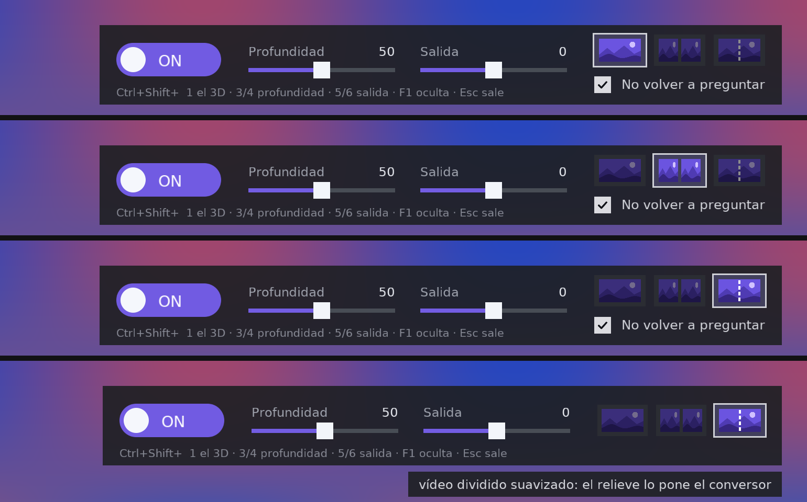
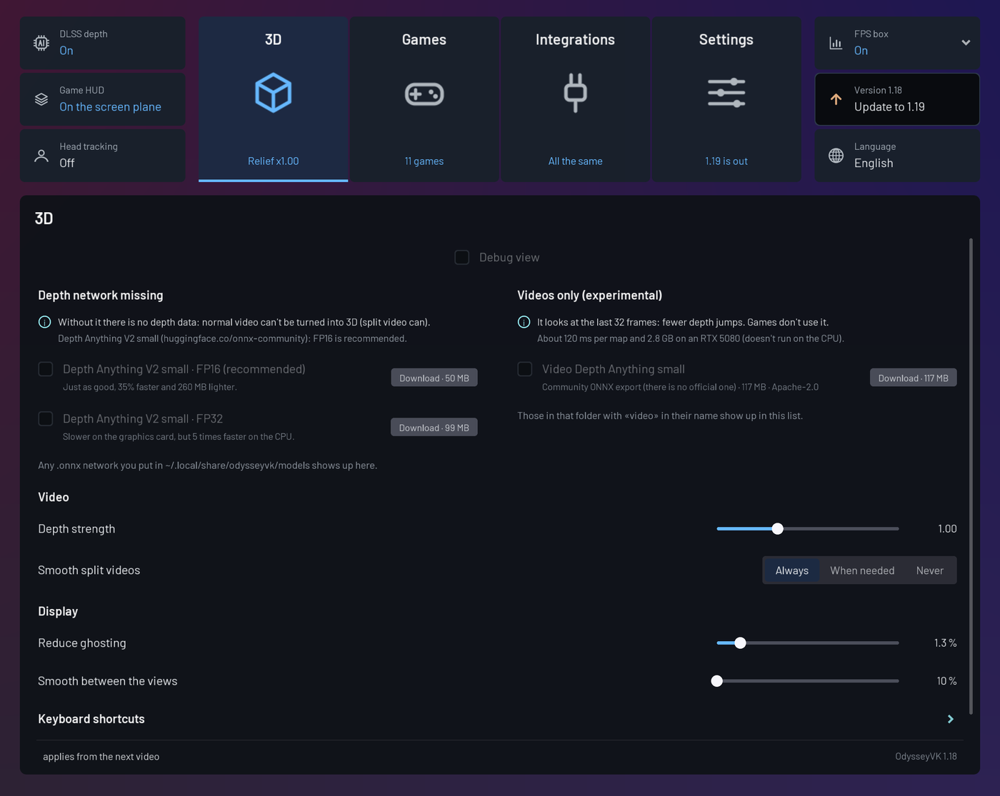
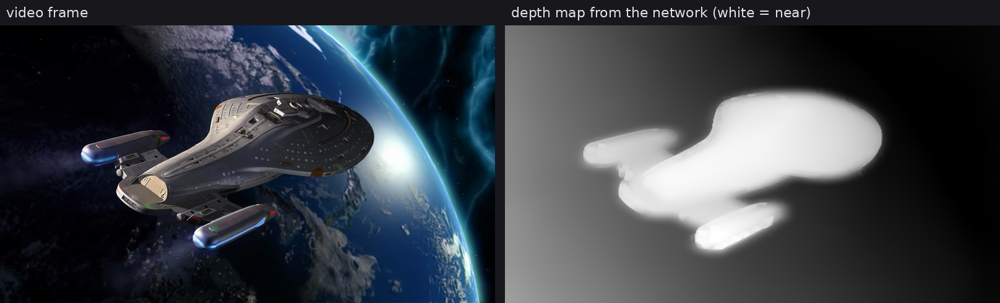
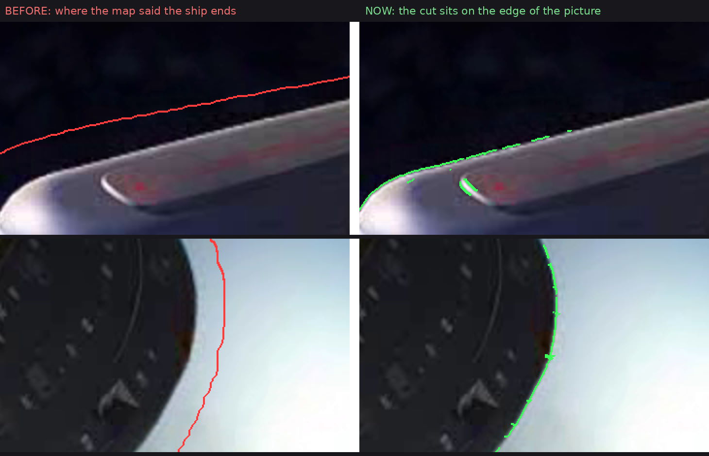
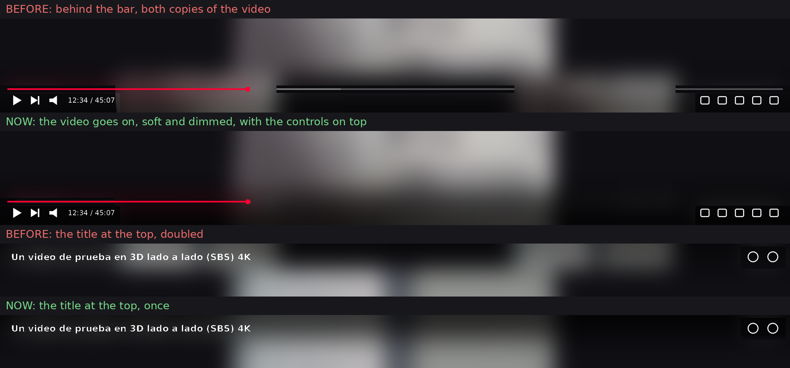
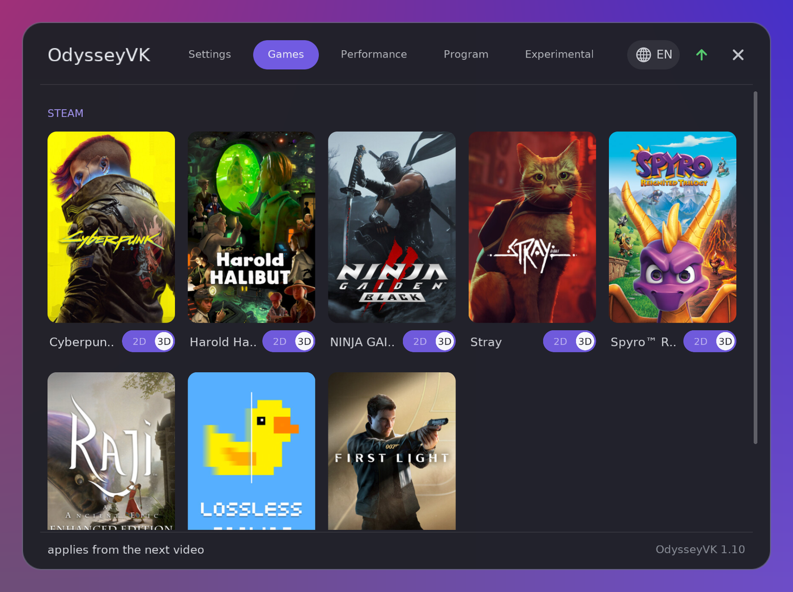
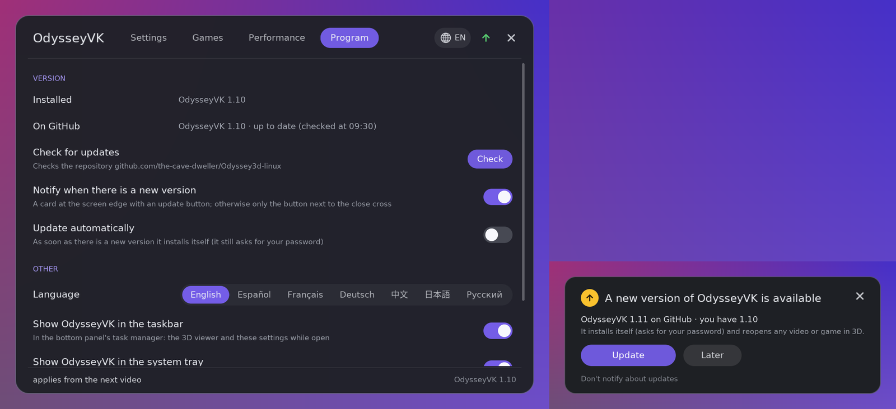

# OdysseyVK — 3D sin gafas en el Samsung Odyssey 3D (G90XF) para Linux

[English](README.md) · **Español**

OdysseyVK maneja el Samsung Odyssey 3D G90XF (lente lenticular y seguimiento de ojos) en **Linux
con Wayland** (KDE Plasma). Enciende la lente y el modo 3D del monitor, teje las dos vistas para
tus ojos, sigue tu cabeza con la cámara infrarroja del propio monitor y lo apaga todo al salir.
Samsung solo da programa para Windows; esto es un port hecho desde cero en C++ y Vulkan.

Lo que tienes:

- **Vídeos lado a lado y arriba-abajo** en 3D, desde cualquier reproductor o navegador a pantalla completa.
- **Vídeo normal (2D) a 3D** con una red de profundidad que corre en tu tarjeta gráfica (modelo abierto, se baja una vez).
- **Juegos** de tu biblioteca de Steam, cada uno con su interruptor 2D/3D.
- Un **panel de ajustes** flotante sobre el escritorio o el vídeo, actualizaciones desde este
  repositorio y desinstalación con un clic.



## Instalar

Arch / CachyOS, todo de una vez (una NVIDIA con CUDA para el conversor 2D→3D; lo demás va en
cualquier tarjeta con Vulkan 1.3):

```bash
sudo pacman -S --needed cmake gcc pkgconf git glfw openssl libpng freetype2 vulkan-icd-loader vulkan-headers glslang wayland plasma-wayland-protocols libpipewire systemd-libs mpv onnxruntime-cuda cuda cudnn
```

```bash
git clone https://github.com/the-cave-dweller/Odyssey3d-linux.git && cd Odyssey3d-linux && ./install.sh
```

`install.sh` compila, pide tu clave una vez (binario, regla udev y datos de calibración) e instala
el servicio de usuario y la entrada del menú. Luego:

```bash
systemctl --user start odysseyvk-serve
```

```bash
odysseyvk doctor
```

`doctor` tiene que listar la lente (`/dev/ttyACM0`), el scaler (`/dev/sgN`, vendor `GCREADER`), la
cámara (`04e8:20d7`) y el panel en 4K. Si no los ve, **desenchufa y vuelve a enchufar el cable USB-B
del monitor** una vez (la regla udev se aplica al reconectar). Nunca hagas `udevadm trigger` sobre
el monitor: reinicia su hub interno y la lente, el scaler y la cámara desaparecen hasta reconectar.

La primera vez que el servicio arranca sin red de profundidad, el panel de ajustes se abre solo y
ofrece bajarla (95 MB, Depth Anything V2 pequeña, de
[huggingface.co/XnetShadow/depth_anything_v2_small](https://huggingface.co/XnetShadow/depth_anything_v2_small)).
Desde la terminal es:

```bash
odysseyvk ctl red descargar
```



## Uso

Pon un vídeo a pantalla completa. Sale una tarjeta en la esquina: **Vídeo normal** (una imagen,
se convierte a 3D) o **Vídeo dividido** (lado a lado). Elige; la pastilla de arriba a la derecha se
queda mientras el 3D está puesto, con el interruptor, la profundidad, la salida y el engranaje que
abre el panel. Marca «guardar» y esa aplicación entra directa en 3D la próxima vez.

Teclas (valen aunque el vídeo o el juego tengan el teclado):

| Teclas | Qué |
|---|---|
| `Ctrl+Shift+1` | 3D puesto / apagado |
| `Ctrl+Shift+3` / `4` | 3D Profundidad baja / sube |
| `Ctrl+Shift+5` / `6` | 3D Salida baja / sube |
| `Ctrl+Shift+F1` | ocultar / mostrar la pastilla |
| `Esc` (en el visor) | salir del 3D |

Los ajustes están en el panel (engranaje de la pastilla, o OdysseyVK en el menú de aplicaciones)
y en `~/.config/odysseyvk/serve.conf`; el servicio recoge los cambios sin reiniciar.

## Por qué el 3D se ve bien

**Profundidad de una sola imagen.** Para el vídeo normal, una red mira cada cuadro y dice a qué
distancia está cada píxel; el visor corre la imagen para cada ojo según eso. Los topes de cerca y
lejos son los del propio programa de Samsung, así que nada pasa de lo que la lente enseña limpio.



**Los bordes en su sitio.** El mapa de la red es grueso (518 puntos a lo ancho de 4K) y sus bordes
caen a unos milímetros del contorno real. OdysseyVK afina cada borde contra el color de la imagen,
píxel a píxel, para que el contorno de cada objeto esté donde lo ves en los dos ojos. Medido en
cuadros reales: el borde queda a menos de 2 píxeles en el 96 % de los cantos (antes, a 26).



**El sujeto se queda en la pantalla.** El plano de la pantalla se pone en lo que estás mirando
(la idea de saliencia del Hub): las caras quedan nítidas y el fondo se abre detrás.


**Los vídeos divididos con demasiado relieve se doman.** Algunos separan lo cercano varios
centímetros, más de lo que la lente puede enseñar. El «vídeo dividido suavizado» usa la imagen
izquierda con el relieve del conversor, solo cuando hace falta si así lo pones.

**Los mandos del reproductor salen enteros.** En un vídeo dividido el reproductor pinta su barra
a lo ancho de las dos mitades. OdysseyVK encuentra esas filas y enseña los mandos una vez, sobre el
vídeo desenfocado y atenuado, para que la barra esté donde picas.



**Juegos.** La pestaña Juegos lista tu biblioteca de Steam con carátulas; cada juego tiene un
interruptor 2D | 3D. Arráncalo desde ahí y entra en 3D solo.



## Mantenerlo al día

El servicio mira este repositorio cada seis horas. Con una versión nueva sale una tarjeta en la
esquina con **Actualizar**, **Luego** y un «no avisar» chico; el botón junto al aspa del panel se
pone amarillo (flecha verde = al día). Actualizar baja, compila, instala (polkit pide tu clave en
una ventana), reinicia el servicio y reabre el vídeo o juego que estaba en 3D. La pestaña
**Programa** tiene además «Actualizar automáticamente» (apagado de fábrica) y **Desinstalar**.



## Configuración

`~/.config/odysseyvk/serve.conf`, una `clave = valor` por línea. Las que puedes querer:

| Clave | Qué hace |
|---|---|
| `modo = ask \| conv \| sbs` | preguntar con la tarjeta / siempre vídeo normal / siempre dividido |
| `auto = app:conv` | una aplicación que entra directa en 3D (lo escribe el «guardar» de la tarjeta) |
| `pantalla = DP-4` | qué salida es el Odyssey |
| `rastreo = si` | seguir los ojos con la cámara infrarroja del monitor |
| `relieve = 1,00` | fuerza del relieve del conversor (0,5 … 2) |
| `dividido_suavizado = si \| auto \| no` | suavizar los divididos: siempre / si hace falta / nunca |
| `crosstalk_base = 0,013` | cuánto de la imagen del otro ojo se resta (fantasma) |
| `hz = 165` | frecuencia del panel en 3D (120 de fábrica) |
| `hdr_en_3d = si` | mantener el HDR durante el 3D |
| `actualizaciones = no` / `actualizar_auto = si` | sin tarjeta de actualización / instalar solas |
| `actualizaciones_cada = 6` | horas entre miradas a este repositorio (6 de fábrica) |

Lo demás (calibrar el paso de la lente, el rastreo, los dos planos, las variables de taller) está
en las guías.

## Documentación

- [docs/GUIDE.md](docs/GUIDE.md) — la guía corta en inglés: todas las órdenes, las teclas y los problemas típicos.
- [docs/GUIA.md](docs/GUIA.md) — el manual completo en español, con las mediciones detrás de cada decisión.
- [CAMBIOS.md](CAMBIOS.md) — qué cambió en cada versión.

## Con qué se hizo

Samsung Odyssey 3D G90XF, KDE Plasma 6 en Wayland, NVIDIA RTX 4090 (CachyOS). Las constantes de
la lente vienen de un G90XF; el paso fino de tu unidad se ajusta con `rampa_x` / `rampa_y` (ver la
guía). El cable USB-B del monitor tiene que estar conectado: por él van la lente, el scaler y la cámara.

## Créditos

Sobre el trabajo de [macdissey-3d](https://github.com/Fulviuus/macdissey-3d) (macOS) y
[Linux_3D_SBS_Player](https://github.com/m-j-tilley/Linux_3D_SBS_Player) (modelo de la lente), con
[Depth Anything V2](https://github.com/DepthAnything/Depth-Anything-V2) para la profundidad y
[YuNet](https://github.com/opencv/opencv_zoo) para la detección de cara. Licencia MIT.
