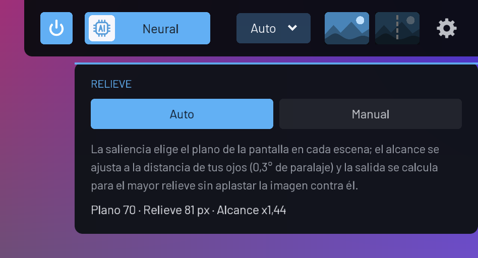
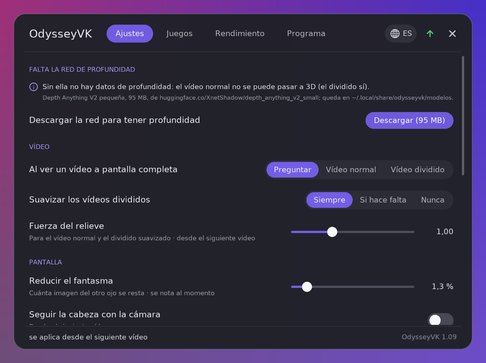
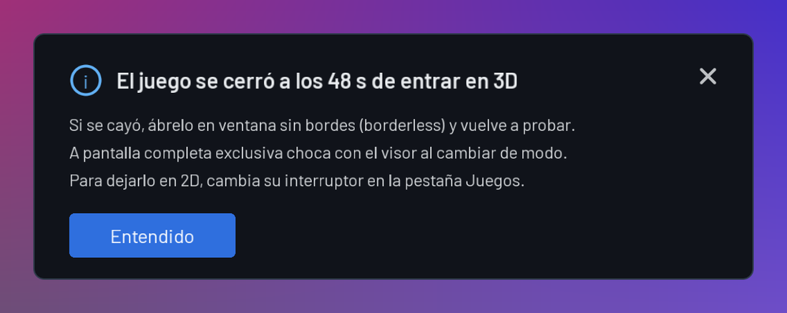

# OdysseyVK — 3D sin gafas en el Samsung Odyssey 3D (G90XF) para Linux

[English](README.md) · **Español**

OdysseyVK maneja el Samsung Odyssey 3D G90XF (lente lenticular y seguimiento de ojos) en **Linux
con Wayland** (KDE Plasma). Enciende la lente y el modo 3D del monitor, teje las dos vistas para
tus ojos, sigue tu cabeza con la cámara infrarroja del propio monitor y lo apaga todo al salir.
Samsung solo da programa para Windows; esto es un port hecho desde cero en C++ y Vulkan.

Lo que tienes:

- **Vídeos lado a lado y arriba-abajo** en 3D, desde cualquier reproductor o navegador a pantalla completa.
- **Vídeo normal (2D) a 3D** con una red de profundidad que corre en tu tarjeta gráfica (modelo abierto, se baja una vez).
- **Juegos** de tu biblioteca de Steam, cada uno con su interruptor 2D/3D.
- Un **panel de ajustes** flotante sobre el escritorio o el vídeo, en **7 idiomas** (English,
  Español, Français, Deutsch, 中文, 日本語, Русский), actualizaciones desde este repositorio y
  desinstalación con un clic.



## Instalar

Arch / CachyOS, todo de una vez (una NVIDIA con CUDA para el conversor 2D→3D; lo demás va en
cualquier tarjeta con Vulkan 1.3):

```bash
sudo pacman -S --needed cmake gcc pkgconf git glfw openssl libpng freetype2 vulkan-icd-loader vulkan-headers glslang wayland plasma-wayland-protocols libpipewire systemd-libs mpv onnxruntime-cuda cuda cudnn
```

```bash
git clone https://github.com/the-cave-dweller/Odyssey3d-linux.git && cd Odyssey3d-linux && ./install.sh
```

`install.sh` compila, pide tu clave una vez (binario, regla udev y datos de calibración), instala
la entrada del menú y arranca el servicio de usuario. Luego comprueba que el monitor se ve:

```bash
odysseyvk doctor
```

`doctor` tiene que listar la lente (`/dev/ttyACM0`), el scaler (`/dev/sgN`, vendor `GCREADER`), la
cámara (`04e8:20d7`) y el panel en 4K. Si no los ve, **desenchufa y vuelve a enchufar el cable USB-B
del monitor** una vez (la regla udev se aplica al reconectar). Nunca hagas `udevadm trigger` sobre
el monitor: reinicia su hub interno y la lente, el scaler y la cámara desaparecen hasta reconectar.

La primera vez que el servicio arranca sin red de profundidad, el panel de ajustes se abre solo y
ofrece bajarla (50 MB, Depth Anything V2 pequeña a media precisión, de
[huggingface.co/onnx-community/depth-anything-v2-small](https://huggingface.co/onnx-community/depth-anything-v2-small)).
En la rama `experimental` esta versión fp16, más ligera, es la de fábrica: el mismo mapa con un 35 %
menos de tiempo de red y 260 MB menos en la tarjeta; si ya tienes el archivo de 95 MB de antes, el
panel ofrece la ligera con un botón.
Al acabar la descarga el panel se cierra y la red se carga. Desde la terminal es:

```bash
odysseyvk ctl red descargar
```



## Uso

Pon un vídeo a pantalla completa. Sale una tarjeta en la esquina: **Vídeo normal** (una imagen, se
convierte a 3D) o **Vídeo dividido** (lado a lado). Elige; la pastilla de arriba a la derecha se
queda mientras dura el 3D, con el interruptor ON/OFF, la profundidad, la salida, los dos botones
del tipo de vídeo y el engranaje que abre el panel de ajustes. Marca «No volver a preguntar» y esa
aplicación pasa directa al 3D la próxima vez.

En la rama `experimental` ya no hay tarjeta: el vídeo pasa directo al 3D y el visor mira sus primeros
segundos para distinguir un vídeo normal de uno dividido (lado a lado o arriba y abajo), se cambia
solo y deja de mirar. Compara las dos mitades del cuadro —la imagen y su detalle fino— y se midió con
tres vídeos 3D lado a lado y tres normales (18 de 18 ventanas de 3 s bien en cada uno). Las
aplicaciones marcadas como 2D y los juegos siguen su camino; en la pastilla se puede cambiar a mano.

Teclas (valen aunque el teclado lo tenga el vídeo o el juego):

| Teclas | Qué |
|---|---|
| `Ctrl+Shift+1` | 3D sí / no |
| `Ctrl+Shift+3` / `4` | menos / más profundidad |
| `Ctrl+Shift+5` / `6` | menos / más salida |
| `Ctrl+Shift+F1` | ocultar / mostrar la pastilla |
| `Esc` (en el visor) | salir del 3D |

Cada atajo se cambia en la página principal del panel → **Atajos de teclado** (la sección se pliega con la flechita de su
cabecera, como *Aplicaciones que no preguntan*; las dos empiezan plegadas): pícalo y pulsa la combinación nueva
(necesita Ctrl, Alt o Meta; Esc cancela y la flecha circular vuelve a la de fábrica). Mientras el
panel de ajustes está abierto se queda con todo el teclado, así que el juego de debajo no recibe
teclas; Esc lo cierra.


El panel de ajustes se abre con el engranaje de la pastilla, la entrada OdysseyVK del menú, su
icono en la barra de tareas o el de la bandeja del sistema (clic: ajustes, clic central: juegos).
En la rama `experimental` la cabecera tiene dos filas. En la primera, el logo y el nombre de OdysseyVK
abren la página principal (vídeo, pantalla, atajos de teclado, aplicaciones que no preguntan), y a su
lado un interruptor **AI | Rendimiento** elige el vídeo normal con la red de profundidad (azul, con el
chip) o sin ella (ámbar, con el rayo). En la segunda, centradas: **Juegos**, **Ajustes** (arriba los
datos de rendimiento —visor 3D, red de profundidad, tarjetas gráficas—; luego *Fluidez*: la frecuencia
variable durante el 3D y el tope de arrastre; versión, actualizaciones, idioma, barra de tareas y
bandeja, y **Desinstalar** plegado bajo su flechita) y **Experimental**. Sobre un vídeo o un juego en 3D no sale la de Juegos. En la rama `experimental` el panel toma el color de resaltado de KDE sobre un fondo gris, se
redimensiona desde su esquina de abajo a la derecha y vuelve a abrirse donde y del tamaño que lo
dejaste. Todo está también en
`~/.config/odysseyvk/serve.conf`; el servicio toma los cambios
sin reiniciarse.

### Idioma

**Ajustes → Otros → Idioma** (Programa hasta la 1.11) cambia el idioma al momento: el panel, la pastilla, las tarjetas y el
rótulo de la bandeja. De fábrica va en inglés. El chino y el japonés usan el tipo Noto Sans CJK
(`noto-fonts-cjk` en Arch). (Hasta la 1.11 había también un globo en la cabecera del panel; en la
rama `experimental` ya no está.)

## Qué hace bueno el 3D

**Profundidad desde una sola imagen.** En los vídeos normales una red de profundidad mira cada
cuadro y dice a qué distancia está cada píxel; el visor desplaza la imagen para cada ojo según eso.
Los límites de cerca y lejos son los del programa de Samsung, así que nada pasa de lo que la lente
puede enseñar limpio.


**Los bordes en su sitio.** El mapa de la red es basto (518 puntos a lo ancho de un cuadro 4K) y
sus bordes caen a unos milímetros del contorno real. OdysseyVK afina cada borde contra el color de
la imagen, píxel a píxel, para que el borde de cada objeto esté donde lo ves con los dos ojos.
Medido en cuadros reales: el borde queda a menos de 2 píxeles de la imagen en el 96 % de los bordes
(antes se iba 26 píxeles), sin fantasma del fondo al lado.


**La profundidad y la salida se recuerdan.** El vídeo normal y el dividido suavizado arrancan en
Profundidad 75 (el plano de la pantalla fijo en 0,75) y Salida 50; el dividido con su propio
relieve arranca neutro (50 y 0). Mueve cualquiera de los dos y ese valor queda recordado para ese
tipo de vídeo, cada uno por su lado.

**Lo que miras puede quedarse en la pantalla.** Con `profundidad_conv = auto` el plano de la
pantalla se pone en lo que estás mirando, como hace el Hub de Samsung, así que caras y sujetos
quedan nítidos y el fondo se abre detrás. En
verde, lo que queda en el plano de la pantalla (medido con la 1.07 en cuadros reales): sin
saliencia el plano caía en el espacio detrás de la nave (0,36); ahora es la nave (0,95). En el
globo pasa del fondo del cuadro al borde del globo (0,27 → 0,39).


**Los vídeos divididos demasiado hondos se domestican.** Algunos vídeos lado a lado separan lo
cercano varios centímetros, más de lo que la lente puede enseñar. El «vídeo dividido suavizado» usa
la imagen izquierda y el relieve del conversor, solo cuando hace falta.

**Los mandos del reproductor salen enteros.** En un vídeo dividido el reproductor pinta su barra
sobre las dos mitades. OdysseyVK encuentra esas filas y enseña los mandos una vez, sobre el vídeo,
que sigue suave y atenuado detrás; cuando la barra se esconde, el corte se va con ella.


**Juegos.** La pestaña Juegos lista tu biblioteca de Steam con carátulas; cada juego tiene su
interruptor 2D | 3D. Arráncalo desde ahí y el juego entra solo en 3D al ponerse a pantalla
completa. Los juegos tienen que ir en **ventana sin bordes** (borderless, también con gamescope):
a pantalla completa exclusiva el escritorio pone el juego encima del 3D. Si un juego en 3D tapa el
visor o se cierra poco después de entrar en 3D, OdysseyVK lo avisa con una tarjeta.




## Mantenerlo al día

El servicio mira este repositorio cada seis horas. Con una versión nueva sale una tarjeta en la
esquina con **Actualizar**, **Luego** y un pequeño «No avisar de actualizaciones»; la flecha junto
al aspa del panel se pone amarilla (verde = al día). Actualizar baja, compila, instala (una ventana
pide tu clave), reinicia el servicio y reabre el vídeo o juego que estaba en 3D. La pestaña
**Ajustes** (Programa hasta la 1.11) tiene además «Actualizar automáticamente» (apagado de fábrica) y **Desinstalar**.


## Configuración

`~/.config/odysseyvk/serve.conf`, una `clave = valor` por línea. Las que te pueden interesar:

| Clave | Qué hace |
|---|---|
| `idioma = en \| es \| fr \| de \| zh \| ja \| ru` | idioma de la interfaz (inglés de fábrica) |
| `modo = ask \| conv \| sbs` | preguntar con la tarjeta / siempre vídeo normal / siempre vídeo dividido |
| `auto = app:conv` | una aplicación que pasa directa al 3D («No volver a preguntar» escribe estas) |
| `pantalla = DP-4` | qué salida es el Odyssey |
| `rastreo = si` | seguir tus ojos con la cámara infrarroja del monitor |
| `relieve = 1,00` | fuerza del relieve del conversor (0,5 … 2) |
| `dividido_suavizado = si \| auto \| no` | suavizar los vídeos divididos: siempre / si hace falta / nunca |
| `crosstalk_base = 0,013` | cuánta imagen del otro ojo se resta (fantasma) |
| `profundidad_conv = 75` / `salida_conv = 50` | Profundidad y Salida con que arranca el vídeo normal (`_suave` el dividido suavizado, `_sbs` el dividido); se escriben al mover los deslizadores; `profundidad_conv = auto` = plano automático |
| `hz = 165` | frecuencia del panel en 3D (120 de fábrica; el G90XF también va a 165) |
| `vrr_en_3d = si` | dejar la frecuencia variable (VRR) durante el 3D; de fábrica se apaga mientras dura el 3D (con ella puesta, los juegos por debajo del refresco daban tirones) |
| `atajo_3d = Ctrl+Shift+1` | un atajo (los escribe el panel): `atajo_profundidad_menos`, `atajo_profundidad_mas`, `atajo_salida_menos`, `atajo_salida_mas`, `atajo_pastilla_menos`, `atajo_pastilla_mas`, `atajo_pastilla` |
| `barra_tareas = no` / `bandeja = no` | quitar OdysseyVK de la barra de tareas / de la bandeja |
| `actualizaciones = no` / `actualizar_auto = si` | sin tarjeta de actualización / instalar solo |
| `actualizaciones_cada = 6` | horas entre miradas a este repositorio |

Lo demás (calibración del paso de la lente, seguimiento de cabeza, variables de taller) está en
las guías.

## Rama experimental

La rama `experimental` añade al panel una pestaña **Experimental** con pruebas sacadas de leer
[Any2Odyssey](https://github.com/jlobue10/Any2Odyssey): la red de profundidad viendo el cuadro a su
proporción 16:9 (`exp_red = cuadrado | 518 | 770`), un mapa de profundidad más grande
(`exp_mapa = 518 | 770 | 1022`), un tope de arrastre en el suavizado en el tiempo
(`exp_tope_arrastre = si`) y la anticipación de la cabeza en milisegundos (`exp_anticipacion = 25`).
Cada una vale desde el siguiente vídeo; lo que funcione pasa a la versión normal. El **alcance del
relieve** (`exp_topes_red = 2,75`, x1–x4) ensancha los topes por ojo con la red, en marcha: con los de
fábrica, más fuerza o Profundidad solo aplasta la imagen contra ellos (medido: el 85 % del cuadro con
Profundidad 100 y relieve x2).

En el vídeo normal con la red la pastilla se vuelve azul claro: junto al interruptor, un botón con un
**chip «AI»** dice **Auto** o **Manual** y abre su menú. **Auto**: en cada escena un mapa de saliencia
busca lo que llama la atención (una cara, un objeto) y lo deja en el plano de la pantalla, y la salida
se calcula para el mayor relieve que cabe sin aplastar la imagen contra los topes (medido: un 0,9 % del
cuadro en los topes en vez del 61 % con una salida fija). **Manual**: Profundidad y Salida a mano.

Trae también un **modo rendimiento** para el vídeo normal: profundidad sin la red (`exp_sin_red = si`, el
interruptor AI | Rendimiento de la cabecera del panel),
sacada de la propia imagen en el procesador (~9 ms por mapa, sin CUDA y sin el ~1,1 GB que ocupa la red en la tarjeta).
Es más basta que la de la red, pero más estable. La pastilla se vuelve ámbar y, en vez de
Profundidad y Salida, lleva un botón con un rayo: su menú desplegable tiene tres preajustes medidos
(**Suave · Medio · Intenso**) y cuatro deslizadores finos (mezcla, fuerza, alcance y paralaje de la
cabeza), que se aplican al momento; al pasar el ratón por cada uno se ve qué cambia. En este modo la
frecuencia variable queda como la tenga el escritorio.

**Los juegos y el cursor.** Cuando un juego entra al 3D, la pastilla se ve unos segundos, para que
se lean los atajos, y se oculta sola. Si la traes con `Ctrl+Shift+F1`, le quita el cursor al juego
(el juego deja de ser la ventana activa y suelta el cursor encerrado); al ocultarla otra vez, o con
un clic en cualquier parte del juego, se lo devuelve. El panel de ajustes hace lo mismo mientras está
abierto sobre un juego: un clic fuera de él lo cierra y devuelve el control, salvo que lo fijes con el
pin a la izquierda de su nombre: fijado, se queda encima y un clic en el juego solo le devuelve el
ratón y el teclado.

## Documentación

- [docs/GUIA.md](docs/GUIA.md) — el manual completo en español, con las medidas detrás de cada decisión.
- [docs/GUIDE.md](docs/GUIDE.md) — la guía corta en inglés: cada orden, cada tecla, problemas.
- [CAMBIOS.md](CAMBIOS.md) — qué cambió en cada versión.

## El equipo con que se hizo

Samsung Odyssey 3D G90XF, KDE Plasma 6 en Wayland, NVIDIA RTX 4090 (CachyOS). Las constantes del
modelo de la lente vienen de un G90XF; el paso fino de tu unidad se ajusta con `rampa_x` /
`rampa_y` (mira la guía). El cable USB-B del monitor tiene que estar conectado: la lente, el scaler
y la cámara van por él.

## Créditos

Hecho sobre el trabajo de [macdissey-3d](https://github.com/Fulviuus/macdissey-3d) (macOS) y
[Linux_3D_SBS_Player](https://github.com/m-j-tilley/Linux_3D_SBS_Player) (modelo de la lente), con
[Depth Anything V2](https://github.com/DepthAnything/Depth-Anything-V2) para la profundidad y
[YuNet](https://github.com/opencv/opencv_zoo) para detectar caras. Licencia MIT.

Las capturas se hacen con `python3 tools/capturas-readme.py`.
