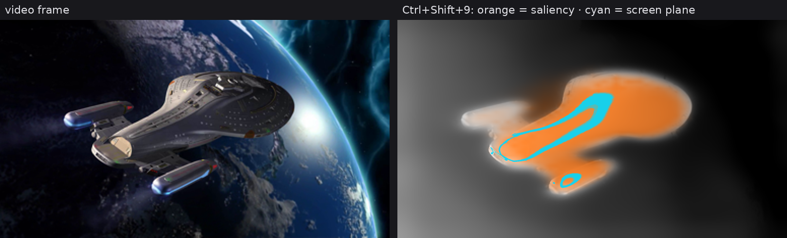

# OdysseyVK — glasses-free 3D on the Samsung Odyssey 3D (G90XF) for Linux

**English** · [Español](README.es.md)

OdysseyVK drives the Samsung Odyssey 3D G90XF (lenticular lens + eye tracking) on **Linux with
Wayland** (KDE Plasma). It turns the lens and the monitor's 3D mode on, weaves the two views for
your eyes, follows your head with the monitor's own IR camera, and turns everything off again when
you leave. Samsung only ships software for Windows; this is a from-scratch C++/Vulkan port.

What you get:

- **Side-by-side and top-bottom videos** in 3D, from any player or browser in fullscreen.
- **Normal 2D video → 3D** with a depth network that runs on your GPU (open model, downloaded once).
- **Games** from your Steam library, each with its own 2D/3D switch.
- A floating **settings panel** over the desktop or the video, in **7 languages** (English,
  Español, Français, Deutsch, 中文, 日本語, Русский), updates from this repository and a one-click
  uninstall.


## Install

Arch / CachyOS, everything in one go (an NVIDIA GPU with CUDA for the 2D→3D converter; the rest
works on any Vulkan 1.3 GPU):

```bash
sudo pacman -S --needed cmake gcc pkgconf git glfw openssl libpng freetype2 vulkan-icd-loader vulkan-headers glslang wayland plasma-wayland-protocols libpipewire systemd-libs mpv onnxruntime-cuda cuda cudnn
```

```bash
git clone https://github.com/the-cave-dweller/Odyssey3d-linux.git && cd Odyssey3d-linux && ./install.sh
```

`install.sh` compiles, asks for your password once (binary, udev rule and calibration data),
installs the menu entry and starts the user service. Then check that the monitor is seen:

```bash
odysseyvk doctor
```

`doctor` must list the lens (`/dev/ttyACM0`), the scaler (`/dev/sgN`, vendor `GCREADER`), the
camera (`04e8:20d7`) and the panel in 4K. If it doesn't see them, **unplug and plug the monitor's
USB-B cable** once (the udev rule applies on reconnect). Never run `udevadm trigger` on the
monitor: it resets its internal hub and the lens, scaler and camera disappear until you replug.

The first time the service starts without a depth network, the settings panel opens by itself
and offers to download it (50 MB, Depth Anything V2 Small at half precision, from
[huggingface.co/onnx-community/depth-anything-v2-small](https://huggingface.co/onnx-community/depth-anything-v2-small)).
Since 1.12 this lighter fp16 version is the default: the same map with 35 % less
network time and 260 MB less GPU memory; if you already have the older 95 MB file, the panel offers
the lighter one with a button.
When the download finishes the panel closes and the network loads. From a terminal it is:

```bash
odysseyvk ctl red descargar
```


## Use

Put a video in fullscreen and it goes straight to 3D. In its first seconds the viewer tells a
**normal video** (one image, converted to 3D) from a **split** one (side by side or top and bottom),
switches by itself and stops looking. It compares the two halves of the frame — the picture and its
fine detail — and was measured on three side-by-side 3D videos and three normal ones (18 of 18
three-second windows right on each). Apps marked as 2D and games keep their own way. (Up to 1.11 a
card in the corner asked which kind of video it was.)

The pill in the top-right corner stays while the 3D is on: a round power button (3D on/off), the
**Neural | Performance** switch (depth with the network or from the image on the CPU, switched on the
spot), the relief button (**Auto** or **Manual**, see below; its menu also has Depth and Pop-out in
Manual and the two video-type buttons to switch by hand) and the gear that opens the settings panel.
Without the converter (a split video shown as it is, or no depth network) the relief button is
Manual only.

Keys (they also work while the video or game has the keyboard):

| Keys | What |
|---|---|
| `Ctrl+Shift+1` | 3D on / off |
| `Ctrl+Shift+3` / `4` | 3D depth down / up |
| `Ctrl+Shift+5` / `6` | 3D pop-out down / up |
| `Ctrl+Shift+F1` | hide / show the pill |
| `Ctrl+Shift+9` | depth debug view (flat, no 3D): the depth in gray (white = near), where saliency weighs in orange (it picks the screen plane in Auto) and what sits on the screen plane in cyan; again to go back |
| `Esc` (in the viewer) | leave 3D |

Every shortcut can be changed in the panel's main page → **Keyboard shortcuts** (the section folds with the arrow
on its header, like *Apps that don't ask*; both start folded): click it and press the new
combination (it needs Ctrl, Alt or Meta; Esc cancels, the circular arrow puts the factory one
back). While the settings panel is open it keeps the whole keyboard, so the game underneath gets
no keys; Esc closes it.


The settings panel opens from the gear on the pill, the OdysseyVK entry in the app menu, its
taskbar icon or the system-tray icon (click: settings, middle click: games). The header has two
rows. On the first, the OdysseyVK logo and name open the
main page (video, screen, keyboard shortcuts, apps that don't ask); the **Neural | Performance** switch
lives on the pill (up to the first 1.12 builds it was here too). On the second, centred: **Games** and **Settings** (the
performance figures — 3D viewer, depth network, GPUs —, then *Smoothness*: variable refresh during 3D,
the drag cap and the viewer's GPU priority; *Head tracking*: following your head with the camera and
head anticipation in milliseconds; *App*: the installed version, what GitHub has and the check/update
button in one row, updates, language, taskbar and tray; and **Uninstall** folded under its arrow).
Each option takes one row: its explanation shows when the mouse rests on it. Over a video
or a game in 3D the Games tab is left out. The panel takes KDE's highlight colour on a slightly transparent black background (like the pill
and its menus), resizes from its bottom-right corner and reopens where and how big you left it. Everything is also in
`~/.config/odysseyvk/serve.conf`; the service picks up changes without restarting.

### Language

**Settings → App → Language** (Other in the first 1.12 builds, the Program tab up to 1.11) switches the language at once: the panel, the pill, the cards and
the tray tooltip. English is the default. Chinese and Japanese use the Noto Sans CJK font
(`noto-fonts-cjk` on Arch). (Up to 1.11 there was also a globe in the panel header.)

## What makes the 3D good

**Depth from a single image.** For normal videos a depth network looks at each frame and tells
how far every pixel is; the viewer then shifts the image for each eye accordingly. The near and
far limits are the ones Samsung's own software uses, so nothing goes beyond what the lens can
show cleanly.


**Edges in the right place.** The network's map is coarse (518 points across a 4K frame) and its
edges land a few millimetres away from the real outline. OdysseyVK refines every edge against the
colour of the image, per pixel, so each object's border is where you see it in both eyes. Measured
on real frames: the edge is within 2 pixels of the picture for 96 % of edges (it was 26 pixels
off before), with no ghost of the background beside it.


**Depth and pop-out are remembered.** Normal video and smoothed split video start at Depth 75
(the screen plane fixed at 0.75) and Pop-out 50; plain split video starts neutral (50 and 0). Move
either slider and that value is remembered for that kind of video, each one on its own.

**The subject can stay on the screen.** With `profundidad_conv = auto` the plane of the screen is
placed on what you are looking at, as Samsung's Hub does, so faces and subjects stay sharp and the
background opens behind. In
green, what sits on the screen plane (measured with 1.07 on real frames): without saliency the
plane fell on the space behind the ship (0.36); now it is the ship (0.95). On the globe it moves
from the back of the frame to the globe's rim (0.27 → 0.39).


**See what the 3D is built from.** `Ctrl+Shift+9` swaps the 3D for a flat view of the depth the
viewer is using, refined edges and anchored subtitles included: gray is the depth (white = near),
orange is where saliency weighs (in Auto it picks the screen plane; the brightest orange is what
weighed most in that frame) and cyan is what sits on the screen plane, the part that stays still and
sharp. A line under the pill explains the colours; press it again to go back to 3D. It needs the
converter (a normal video or a smoothed split one) and works in Neural and Performance alike. Below,
the same ship frame: saliency covers the ship and the screen plane runs along its hull.



**Split videos that are too deep get tamed.** Some side-by-side videos separate near objects by
several centimetres, more than the lens can show. "Smoothed split video" uses the left image and
the converter's relief instead, automatically when needed.

**The player's controls stay whole.** In a split video the player paints its bar across both
halves. OdysseyVK finds those rows and shows the controls once, over the video, which goes on
soft and dimmed behind them; when the bar hides, the cut goes away with it.


**Games.** The Games tab lists your Steam library with covers; each game has a 2D | 3D switch.
Launch from the tab and the game enters 3D on its own when it goes fullscreen. Games must run in
**borderless window** mode (also under gamescope): in exclusive fullscreen the desktop puts the
game above the 3D. If a game in 3D covers the viewer or closes shortly after entering 3D,
OdysseyVK says so with a card.


## Keeping it up to date

The service checks this repository every six hours. With a new version, a card appears in the
corner with **Update**, **Later** and a small "Don't notify about updates"; the arrow next to the
close cross in the panel turns yellow (green = up to date). Update downloads, builds, installs
(a window asks for your password), restarts the service and reopens the video or game that was
in 3D. The **Settings** tab (Program up to 1.11) also has "Update automatically" (off by default) and **Uninstall**.


## Configuration

`~/.config/odysseyvk/serve.conf`, one `key = value` per line. The ones you may want:

| Key | Meaning |
|---|---|
| `idioma = en \| es \| fr \| de \| zh \| ja \| ru` | interface language (English by default) |
| `modo = ask \| conv \| sbs` | ask with the card / always normal video / always split video |
| `auto = app:conv` | an app that goes straight to 3D (the card's "Don't ask again" writes these) |
| `pantalla = DP-4` | which output is the Odyssey |
| `rastreo = si` | follow your eyes with the monitor's IR camera (Settings → Head tracking) |
| `relieve = 1,00` | strength of the converter's relief (0,5 … 2) |
| `dividido_suavizado = si \| auto \| no` | smooth split videos: always / when needed / never |
| `crosstalk_base = 0,013` | how much of the other eye's image to subtract (ghosting) |
| `filtro = 10` | slope of the weave filter between the two views: the change from one view to the other takes 1/slope of the cycle (Samsung's 10 is almost a step; the panel's "Smooth between the views" writes it) |
| `profundidad_conv = 75` / `salida_conv = 50` | starting Depth and Pop-out for normal video (`_suave` smoothed split, `_sbs` split); written when you move the sliders; `profundidad_conv = auto` = automatic screen plane |
| `hz = 165` | panel refresh rate in 3D (default 120; the G90XF also runs at 165) |
| `vrr_en_3d = si` | keep variable refresh (VRR) during 3D; by default it is switched off while the 3D runs (with it on, games below the refresh rate stuttered) |
| `atajo_3d = Ctrl+Shift+1` | a shortcut (the panel writes these): `atajo_profundidad_menos`, `atajo_profundidad_mas`, `atajo_salida_menos`, `atajo_salida_mas`, `atajo_pastilla_menos`, `atajo_pastilla_mas`, `atajo_pastilla` |
| `barra_tareas = no` / `bandeja = no` | hide OdysseyVK from the taskbar / the system tray |
| `actualizaciones = no` / `actualizar_auto = si` | no update card / install updates automatically |
| `actualizaciones_cada = 6` | hours between checks of this repository |

Numbers use a decimal comma in this file. Everything else (lens pitch calibration, head tracking,
workshop variables) is in the guides.

## Relief: Auto and Manual

In normal video with the network the pill turns light blue: next to the switch, a button with a chip
says **Auto** or **Manual** and opens its menu.

- **Auto**: in each scene a saliency map finds what draws the eye (a face, an object) and puts it on
  the screen plane. The depth reach follows the distance of your eyes (0.3° of parallax
  between the eyes, never below the factory limits: those up to 75 cm, 1.33 times them at 1 m), and the pop-out is worked out for the most
  relief that fits without flattening the image against those limits (measured: 0.9 % of the frame on
  the limits instead of 61 % with a fixed pop-out).
- **Manual**: Depth and Pop-out by hand, with the same automatic reach.

Subtitles and captions stay on the screen plane, each line in one piece. On thin edges the depth
step follows the colour of the picture, and what an object uncovers when it shifts is filled with the
background next to it.

## Performance mode

Depth without the network (`exp_sin_red = si`, the **Neural | Performance** switch on the pill,
switched on the spot), worked out from the image itself on the CPU (~9 ms per map, no CUDA, and without the network's
~1.1 GB on the GPU). It is rougher than the network but steadier. The pill turns amber and carries a
lightning-bolt button: its drop-down menu has three measured presets (**Gentle · Medium · Intense**)
and four fine sliders (mix, strength, reach, head parallax), all applied at once; hover over each to
see what it changes. In this mode variable refresh is left as the desktop has it.

## Games and the cursor

When a game enters 3D the pill shows for a few seconds, so the shortcuts
can be read, and then hides by itself. While you bring it back with `Ctrl+Shift+F1` it takes the
cursor from the game (the game stops being the active window, so it lets go of a locked cursor);
hiding it again, or clicking anywhere on the game, gives the cursor back. The settings panel does
the same while it is open over a game: a click outside it closes it and returns control, unless you
pin it with the pin left of its name: pinned, it stays on top and a click on the game just gives the
game the mouse and keyboard back.

## The Experimental tab, until 1.11

The trials it had (taken from reading [Any2Odyssey](https://github.com/jlobue10/Any2Odyssey)) went to
the normal version in 1.12 or stayed as `serve.conf` keys: the network seeing the frame at its 16:9
proportion (`exp_red = cuadrado | 518 | 770`) and a bigger depth map (`exp_mapa = 518 | 770 | 1022`),
keys only; the drag cap and the viewer's GPU priority, in *Settings → Smoothness*; head anticipation,
in *Settings → Head tracking*; the depth reach is worked out by itself in Auto and Manual.

## Documentation

- [docs/GUIDE.md](docs/GUIDE.md) — the short guide in English: every command, every key, troubleshooting.
- [docs/GUIA.md](docs/GUIA.md) — the full manual in Spanish, with the measurements behind each decision.
- [CAMBIOS.md](CAMBIOS.md) — what changed in each version (Spanish).

## Hardware this was built on

Samsung Odyssey 3D G90XF, KDE Plasma 6 on Wayland, NVIDIA RTX 4090 (CachyOS). The lens model
constants come from a G90XF; the fine pitch of your unit is tuned with `rampa_x` / `rampa_y`
(see the guide). The monitor's USB-B cable must be connected: lens, scaler and camera go through it.

## Credits

Built on the work of [macdissey-3d](https://github.com/Fulviuus/macdissey-3d) (macOS) and
[Linux_3D_SBS_Player](https://github.com/m-j-tilley/Linux_3D_SBS_Player) (lens model), with
[Depth Anything V2](https://github.com/DepthAnything/Depth-Anything-V2) for depth and
[YuNet](https://github.com/opencv/opencv_zoo) for face detection. MIT license.

The screenshots are made with `python3 tools/capturas-readme.py`.
