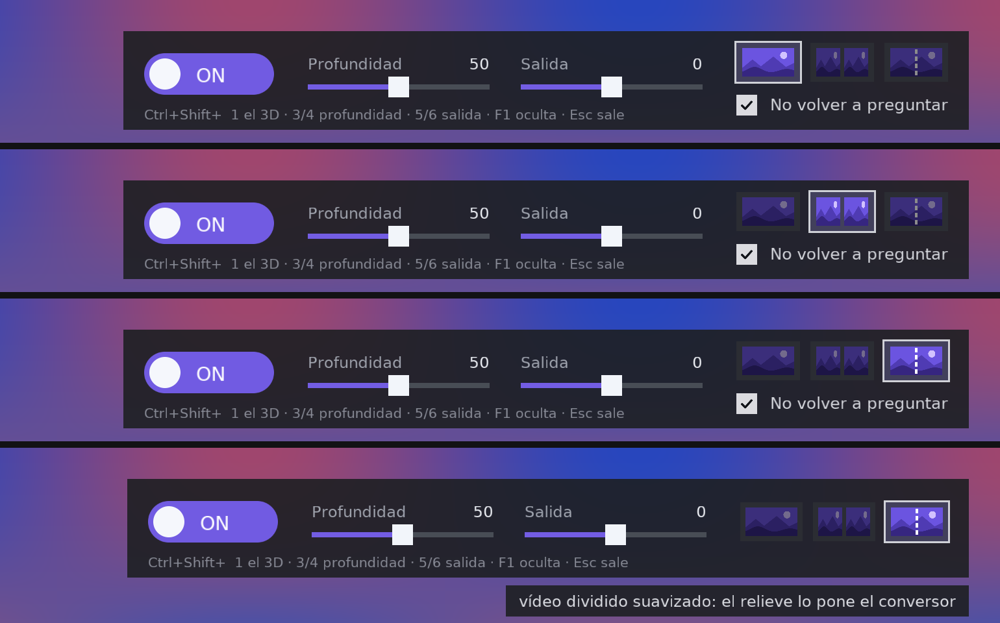
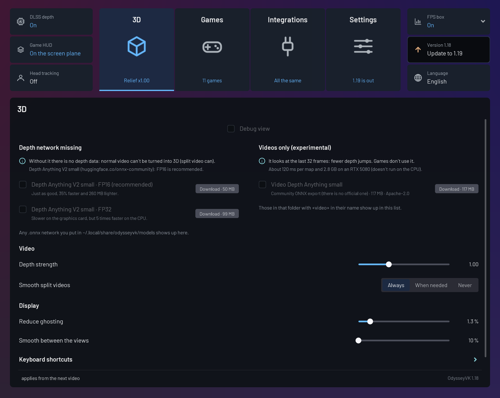
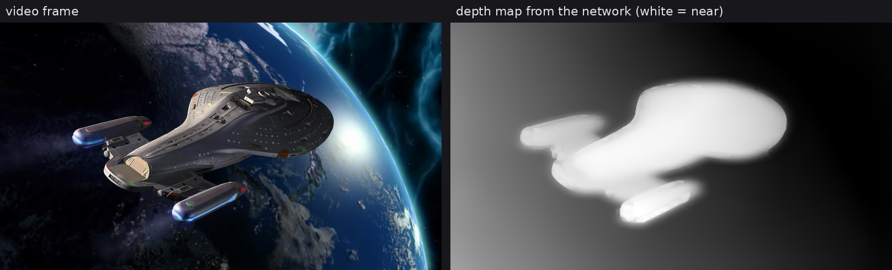
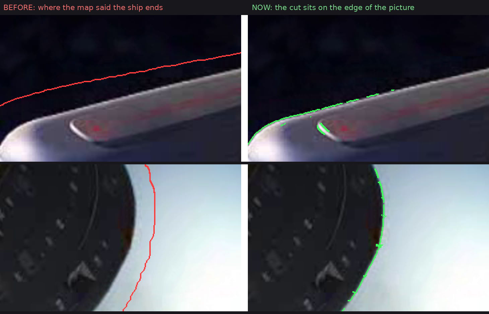
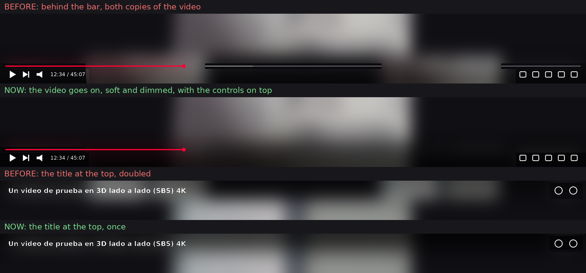
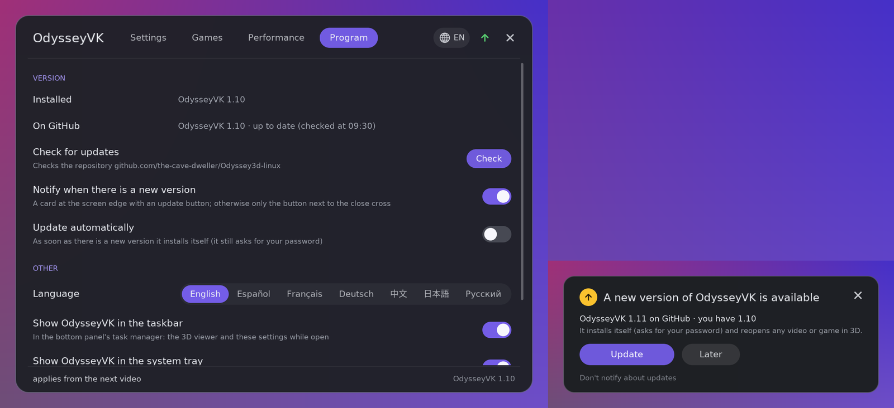

# OdysseyVK — glasses-free 3D on the Samsung Odyssey 3D (G90XF) for Linux

**English** · [Español](README.es.md)

OdysseyVK drives the Samsung Odyssey 3D G90XF (lenticular lens + eye tracking) on **Linux with
Wayland** (KDE Plasma). It turns the lens and the monitor's 3D mode on, weaves the two views for
your eyes, follows your head with the monitor's own IR camera, and turns everything off again when
you leave. Samsung only ships software for Windows; this is a from-scratch C++/Vulkan port.

What you get:

- **Side-by-side and top-bottom videos** in 3D, from any player or browser in fullscreen.
- **Normal 2D video → 3D** with a depth network that runs on your GPU (open model, downloaded once).
- **Games** from your Steam library, each with its own 2D/3D switch.
- A floating **settings panel** over the desktop or the video, auto-updates from this repository,
  and a one-click uninstall.



## Install

Arch / CachyOS, everything in one go (an NVIDIA GPU with CUDA for the 2D→3D converter; the rest
works on any Vulkan 1.3 GPU):

```bash
sudo pacman -S --needed cmake gcc pkgconf git glfw openssl libpng freetype2 vulkan-icd-loader vulkan-headers glslang wayland plasma-wayland-protocols libpipewire systemd-libs mpv onnxruntime-cuda cuda cudnn
```

```bash
git clone https://github.com/the-cave-dweller/Odyssey3d-linux.git && cd Odyssey3d-linux && ./install.sh
```

`install.sh` compiles, asks for your password once (binary, udev rule and calibration data), and
installs the user service plus the menu entry. Then:

```bash
systemctl --user start odysseyvk-serve
```

```bash
odysseyvk doctor
```

`doctor` must list the lens (`/dev/ttyACM0`), the scaler (`/dev/sgN`, vendor `GCREADER`), the
camera (`04e8:20d7`) and the panel in 4K. If it doesn't see them, **unplug and plug the monitor's
USB-B cable** once (the udev rule applies on reconnect). Never run `udevadm trigger` on the
monitor: it resets its internal hub and the lens, scaler and camera disappear until you replug.

The first time the service starts without a depth network, the settings panel opens by itself
and offers to download it (95 MB, Depth Anything V2 Small, from
[huggingface.co/XnetShadow/depth_anything_v2_small](https://huggingface.co/XnetShadow/depth_anything_v2_small)).
From a terminal that is:

```bash
odysseyvk ctl red descargar
```



## Use

Put a video in fullscreen. A card appears in the corner: **Normal video** (one image, converted
to 3D) or **Split video** (side-by-side). Pick one; the pill in the top-right corner stays while
the 3D is on, with the ON/OFF switch, depth, pop-out and the gear that opens the settings panel.
Tick "remember" and that app goes straight to 3D next time.

Keys (they also work while the video or game has the keyboard):

| Keys | What |
|---|---|
| `Ctrl+Shift+1` | 3D on / off |
| `Ctrl+Shift+3` / `4` | 3D depth down / up |
| `Ctrl+Shift+5` / `6` | 3D pop-out down / up |
| `Ctrl+Shift+F1` | hide / show the pill |
| `Esc` (in the viewer) | leave 3D |

Settings live in the panel (gear on the pill, or the OdysseyVK entry in the app menu) and in
`~/.config/odysseyvk/serve.conf`; the service picks up changes without restarting.

## What makes the 3D good

**Depth from a single image.** For normal videos a depth network looks at each frame and tells
how far every pixel is; the viewer then shifts the image for each eye accordingly. The near and
far limits are the ones Samsung's own software uses, so nothing ever goes beyond what the lens
can show cleanly.



**Edges in the right place.** The network's map is coarse (518 points across a 4K frame) and its
edges land a few millimetres away from the real outline. OdysseyVK refines every edge against the
colour of the image, per pixel, so each object's border is where you see it in both eyes. Measured
on real frames: the edge is within 2 pixels of the picture for 96 % of edges (it was 26 pixels
off before).



**The subject stays on the screen.** The plane of the screen is placed on what you are looking
at (the Hub's saliency idea), so faces and subjects stay sharp and the background opens behind.


**Split videos that are too deep get tamed.** Some side-by-side videos separate near objects by
several centimetres, more than the lens can show. "Smoothed split video" uses the left image and
the converter's relief instead, automatically when needed.

**The player's controls stay whole.** In a split video the player paints its bar across both
halves. OdysseyVK finds those rows and shows the controls once, over the video, blurred and
dimmed behind them, so the bar is where you click.



**Games.** The Games tab lists your Steam library with covers; each game has a 2D | 3D switch.
Launch from the tab and the game enters 3D on its own.


## Keeping it up to date

The service checks this repository every six hours. With a new version, a card appears in the
corner with **Update**, **Later** and a small "don't notify"; the button next to the close cross
in the panel turns yellow (green arrow = up to date). Update downloads, builds, installs (polkit
asks your password in a window), restarts the service and reopens the video or game that was in
3D. The **Program** tab also has "Update automatically" (off by default) and **Uninstall**.



## Configuration

`~/.config/odysseyvk/serve.conf`, one `key = value` per line. The ones you may want:

| Key | Meaning |
|---|---|
| `modo = ask \| conv \| sbs` | ask with the card / always normal video / always split video |
| `auto = app:conv` | an app that goes straight to 3D (the card's "remember" writes these) |
| `pantalla = DP-4` | which output is the Odyssey |
| `rastreo = si` | follow your eyes with the monitor's IR camera |
| `relieve = 1,00` | strength of the converter's relief (0,5 … 2) |
| `dividido_suavizado = si \| auto \| no` | smooth split videos: always / when needed / never |
| `crosstalk_base = 0,013` | how much of the other eye's image to subtract (ghosting) |
| `hz = 165` | panel refresh rate in 3D (default 120) |
| `hdr_en_3d = si` | keep HDR during 3D |
| `actualizaciones = no` / `actualizar_auto = si` | no update card / install updates automatically |
| `actualizaciones_cada = 6` | hours between checks of this repository (6 by default) |

Everything else (lens pitch calibration, head tracking, two-plane mode, workshop variables) is in
the guides.

## Documentation

- [docs/GUIDE.md](docs/GUIDE.md) — the short guide in English: every command, every key, troubleshooting.
- [docs/GUIA.md](docs/GUIA.md) — the full manual in Spanish, with the measurements behind each decision.
- [CAMBIOS.md](CAMBIOS.md) — what changed in each version (Spanish).

## Hardware this was built on

Samsung Odyssey 3D G90XF, KDE Plasma 6 on Wayland, NVIDIA RTX 4090 (CachyOS). The lens model
constants come from a G90XF; the fine pitch of your unit is tuned with `rampa_x` / `rampa_y`
(see the guide). The monitor's USB-B cable must be connected: lens, scaler and camera go through it.

## Credits

Built on the work of [macdissey-3d](https://github.com/Fulviuus/macdissey-3d) (macOS) and
[Linux_3D_SBS_Player](https://github.com/m-j-tilley/Linux_3D_SBS_Player) (lens model), with
[Depth Anything V2](https://github.com/DepthAnything/Depth-Anything-V2) for depth and
[YuNet](https://github.com/opencv/opencv_zoo) for face detection. MIT license.
